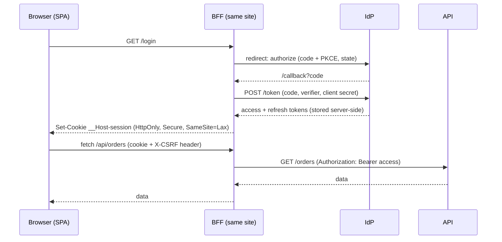

# Where should a single-page app keep auth tokens? Cookies vs memory vs storage, and the BFF pattern
**Round:** 11 · Frontend Security · **Level:** Lead / Staff · **Time:** 15 min · **Tags:** authentication · tokens · cookies
Source: https://whetstone-v1.vercel.app/#security

Scenario: SPA keeps access + refresh tokens in `localStorage`; security calls it an XSS time bomb. Decide where tokens live.

## What they're really testing
Do you reason by threat (exfiltration vs in-session abuse vs CSRF) rather than dogma, and can you explain the BFF's flow, cost and the "HttpOnly doesn't stop XSS" nuance?

## Core answer (key points)
- **Rule:** anything JS can read, injected JS can read.
- **Options vs threats:**

| Storage | XSS can read | Survives reload | CSRF risk | Notes |
|---|---|---|---|---|
| localStorage / sessionStorage | yes | yes (session: per tab) | no | long-lived theft, worst case |
| In-memory variable | yes, while page open | no | no | needs silent refresh, usually via a cookie anyway |
| HttpOnly cookie to API directly | no | yes | yes | API must be same-site or CORS with credentials |
| BFF session cookie | no | yes | mitigated (SameSite + CSRF token) | extra hop + server state |

- **Recommendation for most browser apps: BFF (Backend-for-Frontend).** A server on the app's own site runs the OAuth code+PKCE flow as a confidential client, stores access/refresh tokens server-side per session, and issues the browser only an `HttpOnly; Secure; SameSite=Lax` cookie, ideally `__Host-` prefixed (no Domain attr, Path=/, Secure → locked to exact host). The SPA calls `/api/*` on the BFF, which attaches `Authorization: Bearer` upstream and refreshes tokens transparently.
- **Key nuance:** HttpOnly prevents *exfiltration* (stealing a token for use elsewhere, later). It does not prevent an XSS from making authenticated calls through the victim's browser while it's open. XSS prevention (escaping, CSP) remains primary.
- **Cookies bring CSRF back:** SameSite=Lax + a CSRF token or custom-header check on unsafe methods (see Q04).
- **If tokens must stay in the SPA:** short-lived access token in memory only; rotating refresh tokens with reuse detection; never in URLs (history, logs, Referer); consider DPoP (sender-constrained tokens) so a stolen token is useless without the private key.
- **Logout:** BFF destroys session, revokes refresh token at IdP, calls IdP end-session; SPA clears in-memory state.
- The IETF draft "OAuth 2.0 for Browser-Based Applications" is the reference that recommends BFF; it's still a draft as far as I know, check its current status.

## Mental model / flow


## Code sketch
```ts
// SPA side stays dumb: no token handling at all
export async function api<T>(path: string, init: RequestInit = {}): Promise<T> {
  const res = await fetch(`/bff${path}`, {
    ...init,
    credentials: 'same-origin',
    headers: { 'Content-Type': 'application/json', 'X-Requested-With': 'spa', ...init.headers },
  });
  if (res.status === 401) { location.assign(`/bff/login?returnTo=${encodeURIComponent(location.pathname)}`); }
  if (!res.ok) throw new Error(`API ${res.status}`);
  return res.json() as Promise<T>;
}
```

## Trade-offs & pitfalls
- BFF cost: another service to run/scale, session store (Redis), latency hop, and coupling the SPA's deploy to a server. Worth it for anything handling money/PII.
- Session store becomes sensitive (holds refresh tokens): encrypt at rest, short TTLs.
- Cross-site APIs (api.other.com) + cookies need CORS with credentials and SameSite=None, which reopens CSRF; BFF avoids that by proxying.
- In-memory tokens + refresh-token cookie is a halfway house; fine, but the refresh endpoint now needs CSRF protection.
- Web workers holding tokens reduce exposure a little, but XSS can still message the worker to make calls. I'd present it as marginal.

## Likely follow-ups
- *Why not sessionStorage?* Same XSS readability, just tab-scoped.
- *How does the BFF handle WebSockets/SSE?* Cookie on upgrade request, BFF proxies or mints short-lived tickets.
- *Mobile apps share the API?* They use their own public client with PKCE; BFF is the browser's adapter.
- *Token refresh race in a tab-heavy app?* BFF serialises refresh per session; in SPA-held model use a single-flight refresh promise and BroadcastChannel.

## Say it in 60 seconds
Anything JavaScript can read, an XSS can steal, so `localStorage` is the worst place: long-lived, exfiltratable tokens. Memory is better but still usable while the page is open, and needs a refresh mechanism. My default is a BFF. A same-site server does the code+PKCE flow as a confidential client, keeps access and refresh tokens server-side, and gives the browser only an HttpOnly, Secure, SameSite=Lax `__Host-` cookie. The SPA calls the BFF, which attaches bearer tokens upstream and handles refresh and logout. The honest caveat: HttpOnly stops exfiltration, not XSS acting in-session, so CSP and escaping still matter. Cookies also bring CSRF back, so add SameSite plus a CSRF token or custom header. The cost is one more service and a session store.
