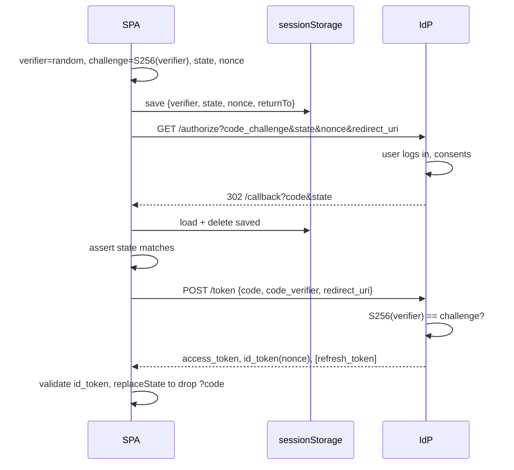

# OAuth 2.1 with PKCE for browser apps, step by step
**Round:** 11 · Frontend Security · **Level:** Lead / Staff · **Time:** 12 min · **Tags:** oauth · pkce · oidc
Source: https://whetstone-v1.vercel.app/#security

Scenario: pure SPA logging in with a third-party IdP. Walk the code+PKCE flow end to end and say which attack each step blocks.

## What they're really testing
Can you sequence the flow precisely and map each parameter (`code_verifier`, `code_challenge`, `state`, `nonce`, exact `redirect_uri`) to the attack it defeats, and know why implicit flow died?

## Core answer (key points)
- **Why not implicit flow:** it returned tokens in the URL fragment: leaks via history, Referer, extensions, logs; no way to bind token to the client. OAuth 2.1 (still a draft as far as I know) removes it; the Security BCP recommends code + PKCE for all clients.
- **Steps:**
  1. Generate `code_verifier` (high-entropy random string, 43-128 chars) and `state` (random); store both in `sessionStorage` (tab-scoped, survives the redirect).
  2. `code_challenge = base64url(SHA-256(verifier))`, `code_challenge_method=S256`.
  3. Redirect to `/authorize` with `response_type=code`, `client_id`, exact `redirect_uri`, `scope=openid ...`, challenge, `state`, and `nonce` for OIDC.
  4. User authenticates at IdP; IdP redirects to `redirect_uri?code=...&state=...`.
  5. App checks `state` matches stored value, then POSTs to `/token` with `code`, `code_verifier`, `redirect_uri`, `client_id`.
  6. IdP hashes verifier, compares to stored challenge, issues access token (+ ID token, maybe refresh token).
  7. Validate ID token (signature, `iss`, `aud`, `exp`, `nonce`), strip `?code` from URL with `history.replaceState`, keep tokens in memory (or do steps 5-6 in a BFF).
- **What each piece blocks:**
  - PKCE: authorization-code interception (malicious app/extension/log grabs the code; useless without the verifier). Also code injection.
  - `state`: login CSRF (attacker makes you complete *their* login) and response mix-up between tabs.
  - `nonce`: ID-token replay.
  - Exact `redirect_uri` registration: open-redirect code theft.
- **Tokens afterwards:** in-memory access token; refresh tokens in browsers only if rotating with reuse detection; otherwise BFF session (see Q03).
- **Silent renew:** hidden-iframe `prompt=none` broke with third-party cookie blocking (Safari ITP, Firefox, Chrome changes); replaced by rotating refresh tokens or BFF.
- **Logout:** clear local state, revoke refresh token, redirect to IdP end-session endpoint.
- **Production:** use a certified library (oidc-client-ts, vendor SDKs); hand-rolled flows miss ID-token validation, clock skew, multi-tab, and renew edge cases.

## Mental model / flow


## Code sketch
```ts
const b64url = (buf: ArrayBuffer | Uint8Array) =>
  btoa(String.fromCharCode(...new Uint8Array(buf as ArrayBuffer))).replace(/\+/g, '-').replace(/\//g, '_').replace(/=+$/, '');
const rand = (n: number) => b64url(crypto.getRandomValues(new Uint8Array(n)));

export async function beginLogin(cfg: { authorizeUrl: string; clientId: string }) {
  const verifier = rand(32), state = rand(16), nonce = rand(16);
  const challenge = b64url(await crypto.subtle.digest('SHA-256', new TextEncoder().encode(verifier)));
  sessionStorage.setItem('oidc', JSON.stringify({ verifier, state, nonce, returnTo: location.pathname }));
  const u = new URL(cfg.authorizeUrl);
  Object.entries({
    response_type: 'code', client_id: cfg.clientId, redirect_uri: `${location.origin}/callback`,
    scope: 'openid profile', code_challenge: challenge, code_challenge_method: 'S256', state, nonce,
  }).forEach(([k, v]) => u.searchParams.set(k, v));
  location.assign(u);
}
// callback: read+delete saved, compare state, POST code+verifier to /token, validate id_token nonce, replaceState.
```

## Trade-offs & pitfalls
- Storing the verifier in `localStorage` shares it across tabs and persists it; `sessionStorage` is the usual choice.
- Not removing `?code` from the URL leaks it to analytics and Referer.
- Skipping ID-token validation because "the IdP returned it over TLS" is wrong when tokens came via front channel or a library is misconfigured.
- Pure SPA = public client, no secret; anything "secret" in the bundle is public. BFF makes it confidential.
- Multiple tabs logging in at once: key saved state by `state` value, not a single slot.

## Likely follow-ups
- *Why S256 not `plain`?* `plain` sends the verifier itself in the front channel; S256 keeps it secret until the back-channel exchange.
- *OAuth vs OIDC?* OAuth is delegated authorization (access tokens for APIs); OIDC adds authentication (ID token, userinfo, `nonce`).
- *Access token audience?* Request tokens scoped to your API (`audience`/resource indicators); don't send ID tokens to APIs.
- *Where would a BFF change this?* Steps 5-7 move server-side with a client secret; browser only sees a session cookie.

## Say it in 60 seconds
Browser apps use authorization code with PKCE; implicit is dead because tokens in the URL fragment leak and can't be bound to the client. The app generates a random `code_verifier`, keeps it and a random `state` in `sessionStorage`, and redirects to the IdP with the SHA-256 `code_challenge`, the state, an OIDC `nonce` and an exact registered redirect URI. The IdP sends back a one-time code. The app checks `state`, then exchanges the code plus verifier for tokens, and the IdP checks the hash matches. PKCE makes an intercepted code useless, `state` blocks login CSRF, `nonce` blocks ID-token replay, and the exact redirect blocks open-redirect theft. Afterwards: validate the ID token, strip the code from the URL, keep tokens in memory or move the exchange into a BFF. In production, use a certified library.
