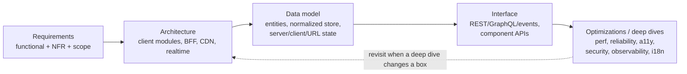

# A framework for frontend system design interviews, and how to spend the 45 minutes
**Round:** 12 · Frontend System Design · **Level:** Senior · **Time:** 12 min · **Tags:** system design · interview framework · radio
Source: https://whetstone-v1.vercel.app/#frontend-system-design

Scenario: vague prompt ("design Google Photos"), 45 minutes. Show the framework that stops the interview turning into a random walk.

## What they're really testing
Can you drive ambiguity to a scoped problem, keep a visible structure, and spend time where the problem is actually hard, while narrating trade-offs?

## Core answer (key points)
- **RADIO:** Requirements → Architecture → Data model → Interface → Optimizations. (Name popularised by GreatFrontEnd's guide.)
- **Time split (45 min):**

| Min | Stage | Artifact on the board |
|---|---|---|
| 0-6 | Requirements | core features, out of scope, users/devices, scale, NFRs |
| 6-15 | Architecture | box diagram: client modules, BFF/server, realtime channel, caches, CDN |
| 15-22 | Data model | entities, normalized store, server vs client vs URL state |
| 22-30 | Interface | endpoints/events + payloads, pagination, error shape, key component APIs |
| 30-42 | Deep dives | the 2-3 genuinely hard parts |
| 42-45 | Wrap-up | trade-offs, what's next, success metrics |

- **Clarifying questions that signal seniority:** devices and network? SEO needed? logged-in only? read/write ratio and update frequency (drives caching/realtime)? freshness and concurrent editing (consistency model)? success metrics (LCP for landing, INP for editors, conversion)?
- **Optimization checklist (say it as a sweep):** performance (rendering mode, splitting, caching, virtualization, images, prefetch); reliability (retry+backoff, partial failure UI, offline, idempotency, optimistic + rollback); a11y (keyboard model, focus, live regions); security (XSS from user content, auth/CSRF, server-side authz); observability (RUM, errors, analytics, flags); i18n (RTL, plurals, formatting, text expansion).
- **Senior vs staff signals:** senior = correct, complete design. Staff = picks the hard part early, quantifies (payload sizes, update rates), names alternatives and why rejected, ties decisions to metrics and team/rollout realities.
- **Common failures:** coding components before requirements; designing the backend in depth; tech-name bingo without reasons; ignoring failure modes and a11y.

## Mental model / flow

Control flow of the *interview*: each stage produces a board artifact that the next stage references; deep dives may loop back to adjust architecture.

## Code sketch
Not code-shaped. A reusable opening line instead:
> "I'll spend about five minutes on requirements, sketch the architecture, define the data and API contracts, then go deep on X and Y, which I think are the hard parts. Stop me if you want a different focus."

## Trade-offs & pitfalls
- Over-long requirements phase eats deep-dive time; cap it and write assumptions down.
- Deep-diving the first thing you know well instead of the thing that's hard for *this* prompt.
- Not keeping a running diagram: interviewer can't follow, and you lose your own place.
- Forgetting to ask what the interviewer wants to emphasise; many will tell you.

## Likely follow-ups
- *How do you pick the deep dives?* Where scale, consistency or latency constraints from requirements bite hardest.
- *How much backend?* Enough to define contracts (API shape, push vs pull, pagination); not database sharding.
- *How do you show trade-offs?* "Option A gives X, costs Y; I pick A because requirement Z."
- *What if interviewer interrupts with a curveball?* Update the requirement list visibly, then show what changes in the diagram.

## Say it in 60 seconds
I run every design round through RADIO: requirements, architecture, data model, interface, optimizations. First about six minutes on scope, devices, scale and non-functional needs like SEO, offline, freshness and accessibility, written as a list. Then a box diagram of client modules, BFF, caches and any realtime channel. Then the data model: entities, the normalized store, and what lives on the server, in the client and in the URL. Then API and event contracts, including pagination and errors. Most of the remaining time goes on two or three deep dives where the problem is genuinely hard, and I close with trade-offs and success metrics. Throughout I keep one diagram current and say why I pick one option over another.
