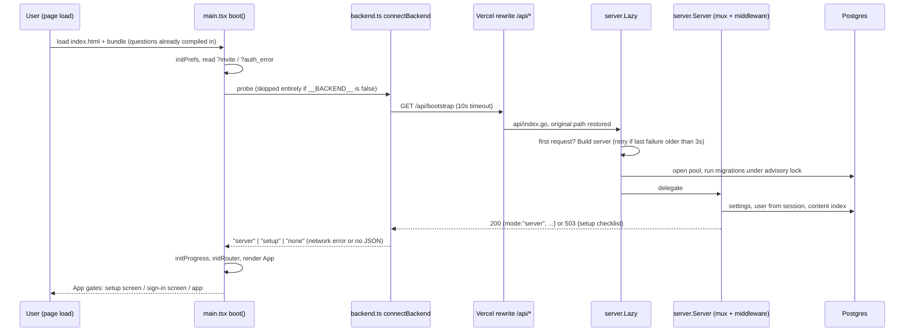

# 01 · The big picture

**Tags:** architecture · react · go · vercel · postgres · **Time:** 12 min · **Files:** 16
Source: https://whetstone-v1.vercel.app/#how-its-built/architecture

## Problem it solves

One codebase has to ship as three products: a static SPA on any host (or a single offline HTML file), a full app with accounts and sync, and a misconfigured deployment that must say so honestly instead of pretending. The architecture decides at boot which of these it is, with one request, and keeps the rest of the app unaware.

## Architecture diagram

## Flow of control

1. `boot()` runs before React mounts: preferences, launch params (invite token, OAuth error) are read from the URL.
2. `connectBackend()` is the single branch point. A build-time constant removes the probe from the static/single-file build, so that build never even tries.
3. If the API answers 200 with `mode: "server"`, the client installs a server-backed loader for per-round answer HTML and hydrates server state (user, flags, content). Mode = `server`.
4. A 503 with a parseable checklist means "API deployed but not configured" (env vars or DB missing). Mode = `setup`, unless the user previously chose to go offline for this session (sessionStorage flag), in which case `none`.
5. Anything else (fetch throws, non-JSON, other status) is `none`: local-only mode, identical to the pre-backend app.
6. Progress store and router initialize with the mode result; then React renders. `App` applies gates in order: setup checklist, sign-in screen for members-only sites, then the app.
7. On the server side, Vercel turns `api/index.go` into one function; `vercel.json` rewrites all `/api/*` to it; a small wrapper restores the original path; `Lazy` builds the real `Server` on first request and caches it.
8. Every request passes middleware, outermost first: panic recovery, security headers, access log, CSRF, session resolution, then the Go 1.22 pattern router (`GET /api/admin/questions/{id}` style, no router library).

## Data flow

- **Content**: Markdown in `content/` is compiled into the JS bundle at build time (outline eagerly, answers as lazy chunks). In server mode, answers come from `/api/content/sections/{id}` instead; same shape either way.
- **State**: a handful of tiny external stores (progress, prefs, route, server state, content) built on a ~30-line `createStore` and read through `useSyncExternalStore`. The router and sync engine write to stores directly, outside React.
- **Route**: a single hash token (`#review`, `#<round>`, `#<question-id>`, `#how-its-built/<id>`) stored in the route store.
- **Server**: `database/sql` + `lib/pq` pool; embedded, forward-only SQL migrations applied at startup inside a transaction holding `pg_advisory_xact_lock`, with a `schema_migrations` table as the ledger.

## Key design decisions and why

| Decision | Why |
|---|---|
| Static SPA with build-time content, not SSR | Authenticated study tool, no SEO need, content changes rarely; deploys to any static host and is fast after first load. |
| One boot probe decides mode | Graceful degradation as a first-class path, not an error branch. The static build is a real product (also the single-file HTML build). |
| Three modes, including `setup` | A half-configured deployment shows a checklist (booleans only, never secret values) instead of silently not syncing. |
| External stores + `useSyncExternalStore` instead of Redux/Zustand | No provider, tiny, usable from non-React code (router, sync). ADR-004. |
| Hash routing | Works on any host including sandboxes where only `#anchors` work; every question is shareable. ADR-003. |
| One Go function for all routes | Shared cold start, one connection pool, one router, same handler runs locally as a binary (`cmd/server`). ADR-018. |
| `Lazy` with retry instead of `sync.Once` | `sync.Once` would cache a failed start (e.g. DB briefly unreachable) until next deploy; `Lazy` retries after a 3-second backoff. |
| Standard library only, no ORM | Every query is visible SQL; things like `FOR UPDATE SKIP LOCKED` are one-line choices. ADR-012, ADR-013. |
| Migrations under an advisory lock | Two concurrent cold starts cannot both migrate. |

## Trade-offs / what you'd change at scale

- **Two modes must both keep working.** CI runs e2e for both; that is a permanent tax on every feature.
- **Migrate-on-cold-start** is fine for a small app; at scale you'd run migrations as a separate deploy step (expand/contract), not inside request latency.
- **One fat function**: at higher traffic you might split hot read paths (content) from write/admin paths for independent scaling and smaller blast radius, or move to a long-running container so connection pooling isn't per-instance (serverless + Postgres usually wants a pooler such as PgBouncer or Neon's pooled endpoint; I'm not certain which the repo uses).
- **Hash routing** blocks SSR/streaming and SEO later; if public pages ever matter, you'd move to path routing with a server/edge renderer for those pages.
- **Hand-rolled stores** don't give devtools, time-travel or selectors-with-memo for free; acceptable at this size.

## Interview talking points

- Frame it as "capability detection at boot": one probe, three explicit modes, the rest of the UI reads a mode flag rather than handling errors everywhere.
- "SPA or SSR?": answer with the product constraints (auth-only, no SEO, rare content changes) and say what would flip it (public SEO pages, low-end devices on slow networks).
- "Why one serverless function?": cold start and pool sharing, single router, local parity; cost is a larger bundle, irrelevant here.
- Show middleware ordering knowledge: recovery outermost, then headers, logging, CSRF before session-dependent handlers.
- State management: argue from requirements (non-React writers, no provider) rather than library fashion; mention `useSyncExternalStore` is tearing-safe under concurrent rendering.

## Source files cited

- https://github.com/anand1296/whetstone/blob/7dde75a085bad2b5cff6306d238711f9aef05648/src/main.tsx
- https://github.com/anand1296/whetstone/blob/7dde75a085bad2b5cff6306d238711f9aef05648/src/platform/backend.ts
- https://github.com/anand1296/whetstone/blob/7dde75a085bad2b5cff6306d238711f9aef05648/.github/workflows/ci.yml
- https://github.com/anand1296/whetstone/blob/7dde75a085bad2b5cff6306d238711f9aef05648/docs/DECISIONS.md
- https://github.com/anand1296/whetstone/blob/7dde75a085bad2b5cff6306d238711f9aef05648/src/app/App.tsx
- https://github.com/anand1296/whetstone/blob/7dde75a085bad2b5cff6306d238711f9aef05648/src/state/createStore.ts
- https://github.com/anand1296/whetstone/blob/7dde75a085bad2b5cff6306d238711f9aef05648/src/state/useStore.ts
- https://github.com/anand1296/whetstone/blob/7dde75a085bad2b5cff6306d238711f9aef05648/src/state/route.ts
- https://github.com/anand1296/whetstone/blob/7dde75a085bad2b5cff6306d238711f9aef05648/api/index.go
- https://github.com/anand1296/whetstone/blob/7dde75a085bad2b5cff6306d238711f9aef05648/vercel.json
- https://github.com/anand1296/whetstone/blob/7dde75a085bad2b5cff6306d238711f9aef05648/backend/server/lazy.go
- https://github.com/anand1296/whetstone/blob/7dde75a085bad2b5cff6306d238711f9aef05648/cmd/server/main.go
- https://github.com/anand1296/whetstone/blob/7dde75a085bad2b5cff6306d238711f9aef05648/backend/server/server.go
- https://github.com/anand1296/whetstone/blob/7dde75a085bad2b5cff6306d238711f9aef05648/backend/store/store.go
- https://github.com/anand1296/whetstone/tree/7dde75a085bad2b5cff6306d238711f9aef05648/backend/store
- https://github.com/anand1296/whetstone/blob/7dde75a085bad2b5cff6306d238711f9aef05648/docs/SPEC.md
