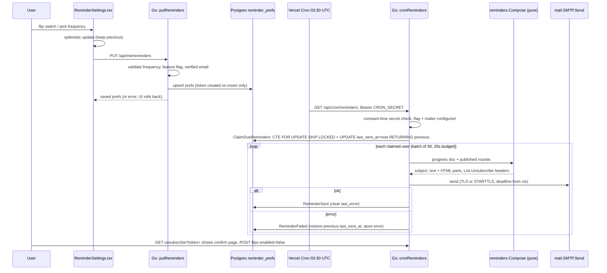

# 02 · Email reminders, end to end

**Tags:** go · postgres · smtp · vercel cron · react · **Time:** 14 min · **Files:** 14
Source: https://whetstone-v1.vercel.app/#how-its-built/email-reminders

## Problem it solves

Opt-in study nudges (daily, every 3 days, weekly) that reach each person exactly once per period, even though the scheduler can fire twice and a serverless function can die mid-run. Constraints: opt-in by default off, only to a verified address, one-click unsubscribe, and no queue/worker/email SDK.

## Architecture diagram

## Flow of control

1. **UI**: the settings component only renders in server mode, for a signed-in user, with the `emailReminders` flag on. Save is optimistic; the server response replaces local state, an error restores the snapshot.
2. **Write path**: handler validates frequency, refuses enable when the feature is off or there's no verified email, then saves.
3. **Schedule**: one cron entry in `vercel.json`. Vercel sends the secret as a bearer token; the handler compares it in constant time, returns 503 if no secret is configured, and short-circuits with a "skipped" JSON if the feature or mailer is off.
4. **Claim**: one SQL statement selects due rows (oldest first, NULLs first), locks them with `SKIP LOCKED`, stamps `last_sent_at = now` and returns the previous timestamp.
5. **Compose**: pure Go, no I/O. Picks a subject by situation (first question / items due / percent done) and a motivation line by rules (all done, nothing done, away 7+ days, items due, 75%+), falling back to a rotation keyed by day-of-year plus user id.
6. **Send**: hand-written SMTP client on the standard library.
7. **Confirm or release**: success clears the last error; failure writes the previous timestamp back so the user becomes due again next run, and records the error for the Settings UI. Confirmation writes use a non-cancelled context so a timed-out run still records results.
8. **Unsubscribe**: GET renders a confirmation only (mail scanners prefetch links); POST from that page or the provider's RFC 8058 one-click POST disables reminders.

## Data flow

- `reminder_prefs` (one row per user who touched the setting): `enabled`, `frequency` (CHECK: daily, every3days, weekly), `unsubscribe_token` (unique, stored raw since it can only turn things off and must appear in the email anyway), `last_sent_at`, `last_error`, `updated_at`.
- Email address comes from GitHub sign-in (`user:email` scope, primary + verified only). Users never type it; admins never see it.
- "Due" is derived: `last_sent_at` older than the frequency gap. Gaps are deliberately shorter than nominal (about 20h, 68h, 164h) because cron fires "sometime within the hour"; an exact 24h gap would skip a day on an early run.
- A partial index on `enabled` keeps the daily scan small when most users are opted out.

## Key design decisions and why

| Decision | Why |
|---|---|
| Claim before send, in one statement | Overlapping runs skip each other's rows; a killed function can't cause resends to already-claimed users. |
| `last_sent_at` is the whole scheduler | No job rows, no per-user cron. State is one timestamp. |
| Release on failure by restoring previous | Gives retry-tomorrow semantics for free; error surfaced in Settings. |
| Pure `Compose` package | Every branch unit-testable (maths, motivation, HTML escaping). |
| `html/template` for the HTML part | Context-aware escaping of question titles. |
| Plain SMTP, not a provider SDK | Same code for Gmail app password (prod), Resend, Postmark, SES, Mailpit locally; switching is an env change. |
| Refuse creds without TLS | Port 465 implicit TLS; otherwise STARTTLS required (except localhost) before auth. |
| CR/LF stripped from headers | Prevents header injection via crafted names. |
| Unsubscribe exempt from CSRF | Authorized by unguessable token, not cookie, so a forged cross-site request gains nothing. Only state-changing exemption besides the cookie-less MCP endpoint. |

## Trade-offs / what you'd change at scale

- Semantics are **at-least-once, rarely twice**: if the send succeeds but the confirm write fails, the next day may resend. Chosen because a duplicate is mildly annoying and a lost email is invisible.
- Fixed batch of 50 within a 25s budget caps throughput per run. At thousands of users: a real queue with idempotency keys, retries with backoff, per-provider rate limits, fan-out workers.
- Gmail app password as a production sender won't scale for deliverability or volume; you'd move to a transactional provider with SPF/DKIM on your domain and bounce/complaint webhooks feeding back into `enabled`.
- Single daily cron at 03:30 UTC ignores user time zones; at scale you'd schedule per local time window.

## Interview talking points

- Name the pattern: lease/outbox without a queue. "Claim atomically, perform side effect, confirm with a separate idempotent write."
- Explain `FOR UPDATE SKIP LOCKED` as a work-queue primitive in Postgres and why it beats `SELECT` then `UPDATE`.
- State the threshold for adding a queue rather than defaulting to one: per-run volume beyond the time budget, need for backoff, provider rate limits.
- Frontend angle: optimistic toggle with snapshot rollback, server response as authority; feature flag and mode gating at render.
- Deliverability: verified sender domain, plain-text part, `List-Unsubscribe` + one-click POST, opt-in only. GET must be side-effect free because scanners prefetch.
- Testing story: pure-logic unit tests, an in-process fake SMTP server checking bytes on the wire, and an integration test against real Postgres that runs cron twice (second must send nothing), forces a failure to prove retry, and checks the secret is required.

## Source files cited

- https://github.com/anand1296/whetstone/blob/7dde75a085bad2b5cff6306d238711f9aef05648/src/features/reminders/ReminderSettings.tsx
- https://github.com/anand1296/whetstone/blob/7dde75a085bad2b5cff6306d238711f9aef05648/backend/store/migrations/002_reminders.sql
- https://github.com/anand1296/whetstone/blob/7dde75a085bad2b5cff6306d238711f9aef05648/backend/store/reminders.go
- https://github.com/anand1296/whetstone/blob/7dde75a085bad2b5cff6306d238711f9aef05648/backend/server/reminders.go
- https://github.com/anand1296/whetstone/blob/7dde75a085bad2b5cff6306d238711f9aef05648/backend/auth/auth.go
- https://github.com/anand1296/whetstone/blob/7dde75a085bad2b5cff6306d238711f9aef05648/vercel.json
- https://github.com/anand1296/whetstone/blob/7dde75a085bad2b5cff6306d238711f9aef05648/backend/reminders/reminders.go
- https://github.com/anand1296/whetstone/blob/7dde75a085bad2b5cff6306d238711f9aef05648/backend/reminders/reminders_test.go
- https://github.com/anand1296/whetstone/blob/7dde75a085bad2b5cff6306d238711f9aef05648/backend/mail/mail.go
- https://github.com/anand1296/whetstone/blob/7dde75a085bad2b5cff6306d238711f9aef05648/backend/mail/mail_test.go
- https://github.com/anand1296/whetstone/blob/7dde75a085bad2b5cff6306d238711f9aef05648/backend/server/server.go
- https://github.com/anand1296/whetstone/blob/7dde75a085bad2b5cff6306d238711f9aef05648/backend/server/server_test.go
- https://github.com/anand1296/whetstone/blob/7dde75a085bad2b5cff6306d238711f9aef05648/docs/DECISIONS.md (ADR-023)
- https://github.com/anand1296/whetstone/blob/7dde75a085bad2b5cff6306d238711f9aef05648/docs/DEPLOYMENT.md
