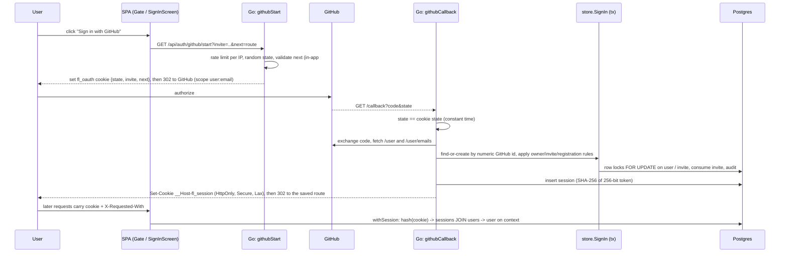

# 03 · Sign-in, sessions and invites

**Tags:** security · oauth · go · postgres · cookies · **Time:** 13 min · **Files:** 12
Source: https://whetstone-v1.vercel.app/#how-its-built/sign-in-and-invites

## Problem it solves

Know who the user is, keep a private-by-default site private, let new people in only by invite (or when the owner opens registration), and resist login-CSRF, CSRF, open redirects, cookie planting and token theft from a DB leak. All with a hand-written GitHub OAuth client and no auth library.

## Architecture diagram

## Flow of control

1. **Start**: refuses with 503 if GitHub isn't configured; rate-limits per client IP (anonymous endpoint). Generates a state token, packs state + invite + validated return route into a short-lived `fl_oauth` cookie, redirects to GitHub.
2. **Callback**: compares returned state to the cookie in constant time (blocks login-CSRF, where an attacker signs you into their account). Exchanges the code, fetches profile and primary verified email. The GitHub access token is used once and never stored.
3. **Policy (`SignIn`, one transaction)**: the login named by `OWNER_GITHUB_LOGIN` always becomes and stays owner (bootstraps a fresh DB). Anyone else new needs a valid invite (not revoked, not expired, uses remaining) unless registration is "open". Users are keyed by GitHub numeric id since logins can be renamed; a stale login is freed. Joining is audited. Row locks stop two tabs or two people racing for a single-use invite.
4. **Session**: new random token, store only its hash, set cookie. Outcomes map to error codes the sign-in screen turns into human sentences.
5. **Every request**: `withSession` reads the cookie (length-capped), hashes, joins to users; on not-found it clears the cookie; puts the user on the request context. Routes declare needs via `signedIn` / `adminOnly` wrappers at registration.
6. **CSRF**: on non-GET requests, require the custom header, reject cross-site `Sec-Fetch-Site`, reject mismatched `Origin`.
7. **Access**: `canRead` returns true for any signed-in user, otherwise only if content access is "public". When false, bootstrap answers `locked: true` with no content and the SPA renders a full-page sign-in.

## Data flow

- Token lifecycle: 32 random bytes, URL-safe base64 to the client; SHA-256 digest to Postgres. Same helper protects sessions, invite tokens and OAuth state.
- Invite: admin picks role (only owner can mint admin invites), uses, expiry; link carries raw token, DB stores hash. The token travels through the OAuth state cookie and is consumed inside the sign-in transaction.
- Cookie attributes: `HttpOnly` (no JS access), `Secure` + `__Host-` prefix on HTTPS (host-only, `Path=/`, cannot be planted by a sibling subdomain), `SameSite=Lax` (not sent on cross-site POST).
- Client side, the CSRF header is added in exactly one place, the API wrapper.

## Key design decisions and why

| Decision | Why |
|---|---|
| Opaque DB-backed sessions, not JWT | Instant revocation (sign out, disable, delete = row gone); nothing sensitive in the cookie. One indexed query per request is cheap at this scale. ADR-014. |
| Hand-written OAuth (~150 lines) | Learning goal; small surface: one provider, one flow, no refresh tokens. |
| SHA-256, not bcrypt/argon2, for tokens | Tokens have 256 bits of entropy, so no dictionary to brute-force; a slow KDF only wastes CPU. Passwords are different. |
| State bound to a cookie | Prevents login-CSRF. |
| `next` validated against an in-app pattern | No open redirect. |
| Three CSRF layers | SameSite alone misses old browsers and same-site subdomains; a custom header can't be sent cross-site without a CORS preflight the server never approves; Fetch Metadata + Origin add a third check. ADR-015. |
| Members-only by default, enforced server-side | Hiding a button isn't access control; withholding data is. ADR-022. |
| Key users by numeric id | Logins are mutable. |

## Trade-offs / what you'd change at scale

- DB lookup per request: at higher scale add a short-TTL cache (with care for revocation latency) or move session lookup to an edge KV.
- In-memory per-IP rate limiter on serverless is per instance, so it's approximate; at scale use a shared store (Redis) or the platform's WAF. (I'm inferring the limiter is in-process from the code shape; verify in `server.go`.)
- Single identity provider; multiple providers would justify an auth library or a hosted IdP plus account linking.
- No refresh/long-lived GitHub token means no ongoing GitHub API access; fine for identity-only use.
- For many services needing identity without a shared store, you'd move to short-lived JWTs plus a revocation strategy, or a BFF that keeps opaque cookies at the edge.

## Interview talking points

- "Sessions or JWTs?": opaque sessions when you own the backend and need revocation; JWTs for distributed verification, with short TTLs and a denylist/rotation plan.
- Walk the OAuth code flow and name each attack it blocks: state cookie (login-CSRF), `next` allowlist (open redirect), constant-time compare (timing), token never stored (blast radius).
- Explain why a fast hash is correct for high-entropy tokens and wrong for passwords.
- "What doesn't SameSite=Lax stop?": same-site attackers on sibling subdomains, top-level GET navigations, older browsers; hence custom header + Origin + `__Host-`.
- Frontend architect angle: centralize CSRF header in one fetch wrapper; render gates from server-provided `locked` state, never from client-only flags.
- Testing: real handler + real Postgres with a fake GitHub, CSRF rejections, private-by-default, a dozen concurrent sign-ins racing a single-use invite, expired/exhausted/revoked invites, disabled users losing sessions; Playwright for sign-in → invite → console.

## Source files cited

- https://github.com/anand1296/whetstone/blob/7dde75a085bad2b5cff6306d238711f9aef05648/docs/DECISIONS.md (ADR-014, ADR-015, ADR-022)
- https://github.com/anand1296/whetstone/blob/7dde75a085bad2b5cff6306d238711f9aef05648/backend/auth/auth.go
- https://github.com/anand1296/whetstone/blob/7dde75a085bad2b5cff6306d238711f9aef05648/backend/server/session.go
- https://github.com/anand1296/whetstone/blob/7dde75a085bad2b5cff6306d238711f9aef05648/backend/store/users.go
- https://github.com/anand1296/whetstone/blob/7dde75a085bad2b5cff6306d238711f9aef05648/src/platform/backend.ts
- https://github.com/anand1296/whetstone/blob/7dde75a085bad2b5cff6306d238711f9aef05648/backend/server/server.go
- https://github.com/anand1296/whetstone/blob/7dde75a085bad2b5cff6306d238711f9aef05648/src/platform/api.ts
- https://github.com/anand1296/whetstone/blob/7dde75a085bad2b5cff6306d238711f9aef05648/backend/server/public.go
- https://github.com/anand1296/whetstone/blob/7dde75a085bad2b5cff6306d238711f9aef05648/src/features/account/Gate.tsx
- https://github.com/anand1296/whetstone/blob/7dde75a085bad2b5cff6306d238711f9aef05648/backend/server/admin.go
- https://github.com/anand1296/whetstone/blob/7dde75a085bad2b5cff6306d238711f9aef05648/backend/server/server_test.go
- https://github.com/anand1296/whetstone/blob/7dde75a085bad2b5cff6306d238711f9aef05648/e2e/server.spec.ts
