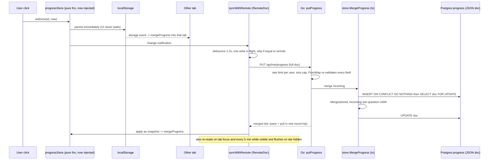

# 04 · Progress that follows you

**Tags:** react · sync · crdt · go · postgres · offline-first · **Time:** 11 min · **Files:** 12
Source: https://whetstone-v1.vercel.app/#how-its-built/progress-sync

## Problem it solves

Ticking a question done (and its spaced-review stage, due date, notes) must feel instant on a train with no signal, survive across tabs and devices, and never let two devices clobber each other. It must also work with no backend at all.

## Architecture diagram

## Flow of control

1. Every mutation is a pure function taking `now` as an argument, so behaviour is deterministic and tests need no fake timers.
2. `initProgress` at boot: load from localStorage, persist on every change, merge writes from other tabs via the `storage` event, wipe a previous user's local copy if a different person signs in, and in server mode start remote sync.
3. The sync engine only depends on a small `RemoteDoc` interface (`set` + `onSnapshot`). It was first written for a document store and is now also backed by an HTTP adapter for the Go API, so the engine is transport-agnostic.
4. Engine rules: debounce writes (~1.2 s), allow one in-flight write and coalesce later changes into exactly one follow-up, skip no-op writes when remote equals local (this also kills the echo loop), flush when the tab becomes hidden (timers may never fire after), classify errors: 401/403 stop syncing, 400/413 go read-only, others retry once with jitter.
5. Server merges under a row lock and returns the merged doc; client merges it back. No push channel: refresh on focus and every five minutes while visible.

## Data flow

- One JSON document per user: map of question id to `{ done, doneAt, stage, dueAt, notes, updatedAt }` plus `lastVisit`.
  - `stage` = index into the review ladder (2/5/12/30/75 days); `dueAt` = when the answer resurfaces in `#review`.
  - `notes` are capped to keep the doc small.
  - `updatedAt` is the LWW clock.
- Merge rule (identical in TS and Go): for each question, the entry with the larger `updatedAt` wins, ties keep the left side; `lastVisit` takes the later one. Go side also caps the number of questions accepted.
- Three replicas: tab A, tab B (same browser, via localStorage), and Postgres (other devices sync through it).

## Key design decisions and why

| Decision | Why |
|---|---|
| Local-first | Browser is the source of truth for UI; server is the source of truth for durability and cross-device. Required anyway for no-backend mode. ADR-005. |
| Last-writer-wins map (simple CRDT) | Commutative and idempotent: replicas converge regardless of order or repetition. |
| Same merge on client and server | Every replica converges to the same state; parity checked by a Go test against the TS behaviour. |
| Full-state replication, debounced | Fewer requests, no out-of-order per-click requests, natural offline story. |
| PUT returns merged doc | One round trip both saves and pulls. |
| `SELECT ... FOR UPDATE` after an ensure-row insert | Concurrent saves from two devices serialize; the second merges into the first's result rather than overwriting. The insert guarantees a row to lock. |
| Polling, not WebSockets | Serverless can't hold connections; nobody needs sub-second progress sync. ADR-017. |
| Re-validate client doc on server | Never trust the client: finite numbers, capped notes, max questions, body size cap, per-user rate limit. |

## Trade-offs / what you'd change at scale

- **Clock skew** is LWW's known weakness: a device with a fast clock wins edits it shouldn't. Acceptable when the blast radius is one person's checkbox. For shared/multi-user data: server-assigned versions, hybrid logical clocks, vector clocks, or an op-based CRDT.
- **Whole-document writes** grow with content; at large docs you'd send deltas (changed entries since last sync) or per-question rows.
- **Per-question granularity only**: `notes` and `done` on the same question can't be merged field-wise; a per-field register map would fix that.
- **Polling cost** scales with active tabs; at scale, SSE or WebSockets from a long-running service, or a sync service (e.g. a managed realtime store).
- JSON blob in one column limits querying progress server-side (summaries, reminders); fine here, but analytics at scale would want normalized rows or a projection.

## Interview talking points

- "Design offline support": local-first store, outbox or full-state replication, a merge rule chosen per field, explicit story for conflicts the rule can't resolve.
- "Why not POST every click?": request volume, out-of-order arrival of concurrent requests, no offline path. Debounced full-state + idempotent merge solves all three.
- Call LWW-map a CRDT and immediately name its failure mode (clock skew) and when you'd upgrade.
- Show the engineering details that make sync robust: single in-flight write with coalescing, echo-loop suppression, flush on `visibilitychange`, error classification into stop / read-only / retry.
- Testing: engine tested against fake remote docs (debounce, echo, retries, terminal errors, snapshot arriving mid-write); Go merge parity test; two simulated devices against the real API and DB.

## Source files cited

- https://github.com/anand1296/whetstone/blob/7dde75a085bad2b5cff6306d238711f9aef05648/docs/DECISIONS.md (ADR-005, ADR-017)
- https://github.com/anand1296/whetstone/blob/7dde75a085bad2b5cff6306d238711f9aef05648/src/state/progress.ts
- https://github.com/anand1296/whetstone/blob/7dde75a085bad2b5cff6306d238711f9aef05648/backend/progress/progress.go
- https://github.com/anand1296/whetstone/blob/7dde75a085bad2b5cff6306d238711f9aef05648/src/state/progressStore.ts
- https://github.com/anand1296/whetstone/blob/7dde75a085bad2b5cff6306d238711f9aef05648/src/state/persistence/cloudSync.ts
- https://github.com/anand1296/whetstone/blob/7dde75a085bad2b5cff6306d238711f9aef05648/backend/server/public.go
- https://github.com/anand1296/whetstone/blob/7dde75a085bad2b5cff6306d238711f9aef05648/backend/store/progress.go
- https://github.com/anand1296/whetstone/blob/7dde75a085bad2b5cff6306d238711f9aef05648/backend/server/server.go
- https://github.com/anand1296/whetstone/blob/7dde75a085bad2b5cff6306d238711f9aef05648/tests/sync.test.ts
- https://github.com/anand1296/whetstone/blob/7dde75a085bad2b5cff6306d238711f9aef05648/tests/server-sync.test.ts
- https://github.com/anand1296/whetstone/blob/7dde75a085bad2b5cff6306d238711f9aef05648/backend/progress/progress_test.go
- https://github.com/anand1296/whetstone/blob/7dde75a085bad2b5cff6306d238711f9aef05648/backend/server/server_test.go
