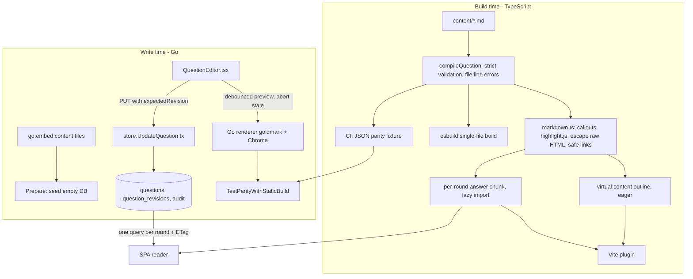

# 05 · Questions, from Markdown to the admin editor

**Tags:** build tooling · markdown · go · react · cms · postgres · **Time:** 15 min · **Files:** 20
Source: https://whetstone-v1.vercel.app/#how-its-built/content-and-cms

## Problem it solves

One question bank, two lifecycles: in git as Markdown (reviewable, works for the static build) and in Postgres as an editable CMS (day-to-day edits by admins). Both must render identical, safe HTML, broken content must fail the build rather than ship, and two admins must not silently overwrite each other.

## Architecture diagram

## Flow of control

**Build time**
1. One Markdown file per round: front matter for the round, one `##` heading per question, then an HTML-comment meta block (id, level, tags, minutes) and a required TL;DR callout.
2. The compiler is strict: missing meta, non-kebab id, unknown level, minutes outside 1–120, no tags, a suspiciously short answer, or no TL;DR all throw a content error with `file:line` and the question title.
3. It lexes once, pulls out the summary and plain-text search index, then renders HTML.
4. Codegen emits virtual modules: an outline module with a loader map of dynamic imports, one per round. Answers load the first time a round opens or on sidebar hover (preload). One cached promise per round so React 19 `use()` suspends exactly once.
5. Same compiler plugged into Vite and esbuild via thin adapters; logic lives in plain unit-tested functions.

**Write time**
1. On an empty DB the Go server parses the same embedded files and seeds Postgres.
2. Admin editor: form + Markdown textarea + live preview rendered by the server (debounced, stale requests aborted), so preview equals what learners see.
3. Save sends the revision the editor loaded. In one transaction: take a content advisory lock, read current revision, return conflict if it changed, snapshot the old row into `question_revisions`, update (moving rounds appends to the end), bump the content version, write an audit entry.
4. A conflict is a 409; the editor offers to load the other person's version.
5. Readers fetch a round's answers in one query, revalidated by an ETag tied to the content version.
6. Console can export back to repo format (per round or zip) and diff repo files vs DB before syncing.

## Data flow

- Markdown → (TS compiler) → HTML + summary + search text → JS chunks (static mode).
- Markdown → (Go compiler at save) → stored alongside Markdown in `questions` (`body`, `html`, `summary`, `search_text`, `revision`, `published`, `updated_by`) → served to readers (server mode).
- Every update → previous snapshot in `question_revisions` (History panel, restore); deletes go to a trash the same way; every action → audit log.
- Content version bump → new ETag → clients revalidate.

## Key design decisions and why

| Decision | Why |
|---|---|
| Markdown in git first | Reviewable diffs, no backend needed for static build, familiar to contributors. ADR-002. |
| Fail the build on bad content | Broken answers never ship; error points at the exact line. |
| Escape-by-construction renderer | All raw HTML escaped, only http(s)/relative/`#` links allowed, so `dangerouslySetInnerHTML` is safe without a runtime sanitizer. ADR-009. |
| Build-time highlighting | Browser ships no Markdown parser or highlighter. |
| Virtual modules + per-round chunks | Small eager outline, answer HTML on demand. |
| Two renderers + a byte-level parity test | Server needs its own renderer for edits; CI compiles with TS, writes a fixture, Go re-renders every question and fails on the first differing byte with an excerpt. |
| Render at write time | Cheap reads; DB stores HTML next to Markdown. ADR-016. |
| Optimistic concurrency via revision | No long locks for a rare conflict; 409 the UI can resolve. |
| Revisions + audit in the same tx | History and accountability can't drift from the write. ADR-021. |
| Git stays long-term home | Export and diff keep the DB from becoming the only copy. |

## Trade-offs / what you'd change at scale

- Two renderers are an ongoing maintenance cost; the parity test catches drift but someone still has to fix both. Alternative: a single renderer (e.g. WASM build of one, or Node at write time).
- A global content advisory lock serializes all content writes; fine for a few admins, a bottleneck with many concurrent editors (move to per-question locking and a monotonic version sequence).
- Whole-round fetch is cheap now; with very large rounds you'd paginate or fetch per question.
- Real-time collaborative editing would need OT/CRDT rather than revision-check-and-409.
- Defense in depth: CSP in `vercel.json` is the second layer behind the safe renderer; Trusted Types could be a third.

## Interview talking points

- "Where should Markdown render?": build time for static content (zero runtime cost, CI catches errors), write time for user-edited content (cheap reads), read time only if output depends on the reader.
- "Two implementations of one spec drift" (client/server validation, two SDKs): the fix is a conformance test fed by real data, not discipline.
- "How do you stop two editors overwriting?": version column + 409 with a resolve path; pessimistic locks only for long exclusive edits.
- "How do you trust injected HTML?": produce it from an escaping renderer, test that guarantee (`TestCompiledHTMLIsSafe`), add CSP.
- Frontend architecture angle: virtual modules as a build-time data layer, code splitting by route/round, hover preloading, stable promises for `use()` + Suspense.

## Source files cited

- https://github.com/anand1296/whetstone/tree/7dde75a085bad2b5cff6306d238711f9aef05648/content
- https://github.com/anand1296/whetstone/blob/7dde75a085bad2b5cff6306d238711f9aef05648/docs/CONTENT_GUIDE.md
- https://github.com/anand1296/whetstone/blob/7dde75a085bad2b5cff6306d238711f9aef05648/docs/DECISIONS.md (ADR-002, ADR-009, ADR-016, ADR-021)
- https://github.com/anand1296/whetstone/blob/7dde75a085bad2b5cff6306d238711f9aef05648/build/content/compile.ts
- https://github.com/anand1296/whetstone/blob/7dde75a085bad2b5cff6306d238711f9aef05648/build/content/markdown.ts
- https://github.com/anand1296/whetstone/blob/7dde75a085bad2b5cff6306d238711f9aef05648/build/content/codegen.ts
- https://github.com/anand1296/whetstone/blob/7dde75a085bad2b5cff6306d238711f9aef05648/src/content/index.ts
- https://github.com/anand1296/whetstone/blob/7dde75a085bad2b5cff6306d238711f9aef05648/build/vite-plugin-content.ts
- https://github.com/anand1296/whetstone/blob/7dde75a085bad2b5cff6306d238711f9aef05648/scripts/build-single-file.ts
- https://github.com/anand1296/whetstone/blob/7dde75a085bad2b5cff6306d238711f9aef05648/tests/compile.test.ts
- https://github.com/anand1296/whetstone/blob/7dde75a085bad2b5cff6306d238711f9aef05648/backend/server/server.go
- https://github.com/anand1296/whetstone/blob/7dde75a085bad2b5cff6306d238711f9aef05648/backend/markdown/markdown.go
- https://github.com/anand1296/whetstone/blob/7dde75a085bad2b5cff6306d238711f9aef05648/backend/catalog/catalog_test.go
- https://github.com/anand1296/whetstone/blob/7dde75a085bad2b5cff6306d238711f9aef05648/.github/workflows/ci.yml
- https://github.com/anand1296/whetstone/blob/7dde75a085bad2b5cff6306d238711f9aef05648/backend/server/public.go
- https://github.com/anand1296/whetstone/blob/7dde75a085bad2b5cff6306d238711f9aef05648/src/features/console/QuestionEditor.tsx
- https://github.com/anand1296/whetstone/blob/7dde75a085bad2b5cff6306d238711f9aef05648/backend/store/content.go
- https://github.com/anand1296/whetstone/blob/7dde75a085bad2b5cff6306d238711f9aef05648/backend/store/settings.go
- https://github.com/anand1296/whetstone/blob/7dde75a085bad2b5cff6306d238711f9aef05648/backend/server/server_test.go
- https://github.com/anand1296/whetstone/blob/7dde75a085bad2b5cff6306d238711f9aef05648/vercel.json
