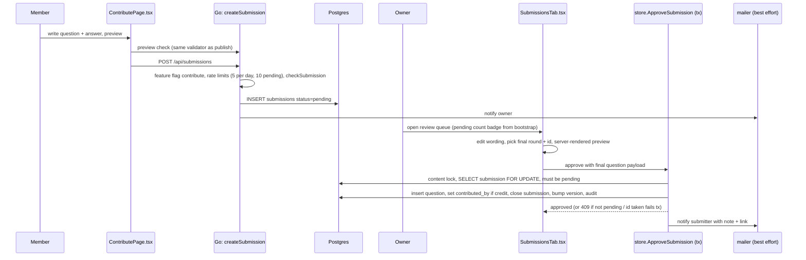
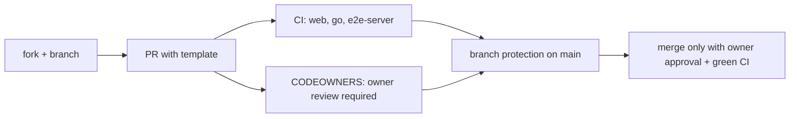

# 06 · Community contributions with a human in the loop

**Tags:** product · go · postgres · react · github · moderation · **Time:** 11 min · **Files:** 13
Source: https://whetstone-v1.vercel.app/#how-its-built/contributions

## Problem it solves

Let members propose questions from real interviews, and let anyone propose code, while guaranteeing nothing reaches other users or `main` without the owner's approval. The gate must be impossible to skip by accident, not just by convention.

## Architecture diagram

Code path (outside the app):

## Flow of control

1. **Submit**: signed-in user fills the form on `#contribute`. A preview calls the same server check, so formatting problems show before submit. Without a backend the form becomes a GitHub issue form.
2. **Validate**: the submission is normalized and run through the exact compiler/validator a published question uses (TL;DR required, safe HTML, tag and length limits), plus submission-only rules: either an existing round or a "suggest a new round" title (3 to a max length), a private reviewer-context field with a size cap.
3. **Abuse limits**: per-person daily cap and pending cap; the whole feature sits behind a flag the owner can switch off from the console without a deploy.
4. **Review**: owner edits in a queue that reuses the editor's building blocks and server preview. The final question (round, id, wording, draft vs published) is part of the approve request, not a second step.
5. **Approve (one transaction)**: lock content, lock the submission row, require `pending`, insert question, credit author if requested, close the submission with reviewer/note/time/question id, bump content version, audit.
6. **Notify**: owner on new submission, author on decision. Best effort, after commit, so an SMTP failure can't turn a committed approval into an error.
7. **Code**: CODEOWNERS + branch protection (required PR, one approving review, code-owner review, re-approval after new pushes, required checks, resolved conversations, no force-push/delete). First-time contributors' Actions runs wait for owner approval.

## Data flow

- `submissions` table: author, proposed round (deliberately not a foreign key, since the round may be renamed or deleted while waiting), optional new-round title, title, level (CHECK senior/lead/principal), tags, minutes (CHECK 1–120), Markdown body, private context, credit flag, status (CHECK pending/approved/rejected/withdrawn), reviewer, review note, resulting question id, timestamps.
- On approval, data moves into `questions` with `contributed_by` (ON DELETE SET NULL: if the contributor deletes their account the question stays, the credit disappears).
- Reader UI shows "Contributed by @login" under the answer.
- Author sees "your submissions" with status and can withdraw.

## Key design decisions and why

| Decision | Why |
|---|---|
| Separate table, not a `pending` flag on `questions` | Unreviewed content is invisible by construction; no reader query, search, reminder or export has to remember a filter forever. |
| Same validation as published content | Review is about content, not formatting; approval is fast. |
| Status as a CHECK-constrained closed set | DB enforces the state machine's vocabulary. |
| Row lock + `pending` check in tx | Prevents double approval from two tabs/admins (409). |
| All approval effects in one tx | No half-approved state; id collision aborts everything. |
| Email best effort post-commit | Side effect failures don't corrupt or misreport state. |
| GitHub enforces code review | The app can't enforce merges; CODEOWNERS + branch protection can. |
| Feature flag on intake | Pause submissions without a deploy. |

## Trade-offs / what you'd change at scale

- Single owner is a bottleneck and a bus factor; at scale you'd add a reviewer role, assignment, SLAs and maybe two-person approval for publishing.
- Post-commit email without an outbox can be lost silently; at scale write a notification row in the same tx and deliver via the claim pattern from 02.
- Rate limits are per-person; a sybil attacker with many invited accounts isn't covered. Invites-only registration mitigates this (see 03).
- No automated content screening (spam, plagiarism, PII); at volume you'd add heuristics or a model-assisted pre-screen before human review.
- Approval is all-or-nothing per question; collaborative back-and-forth (request changes) would need another status and a comment thread.

## Interview talking points

- Core idea: "anyone can propose, one person decides, and the system makes skipping the decision impossible." Same shape in both paths: separate table + transactional approval in the app, CODEOWNERS + branch protection on GitHub.
- "Design user-submitted content with moderation": separate storage, same validation as first-party, per-user limits, audited transactional approval, notifications, kill switch.
- "Protect `main` in an OSS repo": code owners, required reviews and checks, stale-review dismissal, approval for first-time contributor workflows, least-privilege `GITHUB_TOKEN`, private security reporting via `SECURITY.md`.
- Frontend angle: the submit preview and review queue reuse the same server-rendered preview, so what the contributor, reviewer and reader see is identical.
- Testing: one lifecycle test against real Postgres covering validation, rate limits, learners blocked from admin routes, pending invisible to readers, approval crediting + emailing both sides, second approval 409, reject and withdraw.

## Source files cited

- https://github.com/anand1296/whetstone/blob/7dde75a085bad2b5cff6306d238711f9aef05648/backend/store/migrations/003_submissions.sql
- https://github.com/anand1296/whetstone/blob/7dde75a085bad2b5cff6306d238711f9aef05648/backend/server/submissions.go
- https://github.com/anand1296/whetstone/blob/7dde75a085bad2b5cff6306d238711f9aef05648/backend/store/submissions.go
- https://github.com/anand1296/whetstone/blob/7dde75a085bad2b5cff6306d238711f9aef05648/backend/server/public.go
- https://github.com/anand1296/whetstone/blob/7dde75a085bad2b5cff6306d238711f9aef05648/src/features/contribute/ContributePage.tsx
- https://github.com/anand1296/whetstone/blob/7dde75a085bad2b5cff6306d238711f9aef05648/src/features/console/SubmissionsTab.tsx
- https://github.com/anand1296/whetstone/blob/7dde75a085bad2b5cff6306d238711f9aef05648/src/features/section/QuestionItem.tsx
- https://github.com/anand1296/whetstone/blob/7dde75a085bad2b5cff6306d238711f9aef05648/.github/CODEOWNERS
- https://github.com/anand1296/whetstone/blob/7dde75a085bad2b5cff6306d238711f9aef05648/CONTRIBUTING.md
- https://github.com/anand1296/whetstone/blob/7dde75a085bad2b5cff6306d238711f9aef05648/.github/pull_request_template.md
- https://github.com/anand1296/whetstone/tree/7dde75a085bad2b5cff6306d238711f9aef05648/.github/ISSUE_TEMPLATE
- https://github.com/anand1296/whetstone/blob/7dde75a085bad2b5cff6306d238711f9aef05648/SECURITY.md
- https://github.com/anand1296/whetstone/blob/7dde75a085bad2b5cff6306d238711f9aef05648/backend/server/server_test.go
