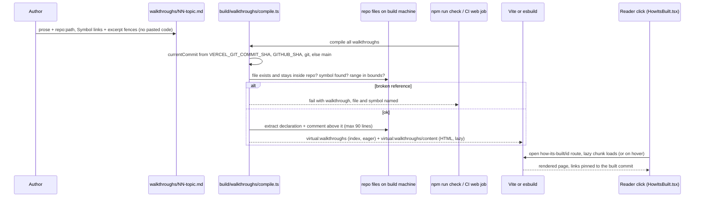

# 07 · How "How it's built" is built

**Tags:** build tooling · documentation · vite · typescript · **Time:** 8 min · **Files:** 7
Source: https://whetstone-v1.vercel.app/#how-its-built/how-its-built

## Problem it solves

Architecture docs rot: functions get renamed, pasted snippets silently go stale, hand-typed line numbers drift. The goal is documentation that cannot disagree with the running code, and that breaks the build the moment it would.

Note: this feature has no Go handler or Postgres path. It is entirely build time; the "backend" in the diagram is the build machine and CI.

## Architecture diagram

## Flow of control

1. **Authoring**: a walkthrough is Markdown with front matter (id, title, summary, order, minutes, tags). Two extensions: a `repo:` link pointing at `path#Symbol`, and a code fence carrying an `excerpt=path#Symbol` attribute with an empty body.
2. **Resolve links**: split path and anchor. Folder refs must exist as directories; `..` is rejected. Explicit `L10-L20` ranges are bounds-checked. Otherwise, find the symbol's declaration line and build a GitHub URL at the commit SHA with `#L<n>`.
3. **Find symbols**: deliberately a line-based heuristic, not a per-language parser: a declaration keyword plus the name, Go method receivers, SQL `CREATE TABLE/INDEX`, JSON/YAML keys, Markdown headings. Tests pin each case.
4. **Extract excerpts**: include the comment block above the declaration (where the "why" lives), follow brackets to the end of the declaration while ignoring brackets in strings/comments; cap at 90 lines unless a range is given.
5. **Pin commit**: CI and Vercel expose the SHA; locally ask git; else fall back to `main`. The page header shows the short SHA.
6. **Validate**: `check-content.ts` compiles every walkthrough; `npm run check` and the CI web job fail on the first broken reference.
7. **Ship**: same virtual-module pattern as the question bank. A small index module in the main bundle; one lazy chunk of HTML fetched on first open or on hover.
8. **Render**: `HowItsBuilt.tsx` index + reader (file list, body, prev/next). Reuses answer styles and the copy-code handler. Routes `#how-its-built` and `#how-its-built/<id>`, behind the `howItsBuilt` feature flag.

## Data flow

Markdown + repo sources → compiler → resolved URLs + quoted source → HTML → virtual modules → lazy chunk → reader. Nothing is fetched from GitHub at runtime.

## Key design decisions and why

| Decision | Why |
|---|---|
| Quote by symbol name, never paste | Snippets are always the current source. |
| Link to symbols, never hand-typed line numbers | Build computes the line. |
| Pin URLs to the built commit | Line numbers can't go stale because the commit can't change; links show the code that is actually deployed. |
| Validation as the feature | A broken ref is a build error before shipping, not a blank box after. |
| Line heuristic over real parsers | Covers every file type quoted in ~30 lines; tests define the contract. |
| Render on the build machine, not runtime GitHub fetch | No rate limits, no network dependency, works in the offline single-file build. |
| Reuse content pipeline (virtual modules, lazy chunks, styles) | No second system to maintain. |

## Trade-offs / what you'd change at scale

- Heuristic symbol lookup can match the wrong declaration (same name in a comment-like line, overloaded names, nested declarations). With many languages or large repos you'd use tree-sitter or language servers.
- Special case: Vercel rewrites `vercel.json` before build, so symbols there can't be verified on Vercel; CI with the real file still checks them. A reminder that "verified at build" depends on the build seeing the real tree.
- Fallback to `main` when no SHA is known makes local links unpinned; acceptable for dev only.
- Excerpts are always current, so the prose around them can still go stale semantically; the build only checks that references resolve, not that the explanation is still true. Review discipline still matters.
- At org scale this generalizes to a docs-as-code platform (e.g. a monorepo docs site with link checking and snippet extraction across repos).

## Interview talking points

- "How do you keep architecture docs from rotting?": make the build the enforcer. Reference code by symbol, inject source at build time, pin links to the commit, fail CI on drift.
- Show you know the limits: it guarantees references exist, not that prose is correct.
- Tie to the same principle as 05: generate from the source of truth and test the guarantee, instead of relying on care.
- Frontend tooling depth: Vite virtual modules, bundler adapters kept thin, eager index + lazy content chunk, hover preloading, feature-flagged route.
- Onboarding value: every walkthrough has the same shape (what it does, diagram, code in request order, decisions and trade-offs, tests, interview angles), which is exactly the template these notes follow.

## Source files cited

- https://github.com/anand1296/whetstone/tree/7dde75a085bad2b5cff6306d238711f9aef05648/walkthroughs
- https://github.com/anand1296/whetstone/blob/7dde75a085bad2b5cff6306d238711f9aef05648/build/walkthroughs/compile.ts
- https://github.com/anand1296/whetstone/blob/7dde75a085bad2b5cff6306d238711f9aef05648/tests/walkthroughs.test.ts
- https://github.com/anand1296/whetstone/blob/7dde75a085bad2b5cff6306d238711f9aef05648/scripts/check-content.ts
- https://github.com/anand1296/whetstone/blob/7dde75a085bad2b5cff6306d238711f9aef05648/build/vite-plugin-content.ts
- https://github.com/anand1296/whetstone/blob/7dde75a085bad2b5cff6306d238711f9aef05648/scripts/build-single-file.ts
- https://github.com/anand1296/whetstone/blob/7dde75a085bad2b5cff6306d238711f9aef05648/src/features/howItsBuilt/HowItsBuilt.tsx
