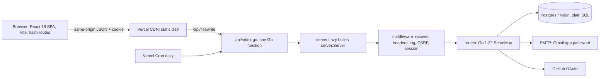

# 16 · How it's built

> Seven architecture walkthroughs of the Whetstone app itself: each follows one feature from the click, through the React SPA and the Go handler, into Postgres and back. Notes are in my own words.
Source: https://whetstone-v1.vercel.app/#how-its-built · Code at commit `7dde75a` (https://github.com/anand1296/whetstone/commit/7dde75a085bad2b5cff6306d238711f9aef05648)

| # | Walkthrough | Tags | Time | Files | Notes |
|---|-------------|------|------|-------|-------|
| 01 | The big picture | architecture · react · go · vercel · postgres | 12 min | 16 | [notes](01-architecture.md) |
| 02 | Email reminders, end to end | go · postgres · smtp · vercel cron · react | 14 min | 14 | [notes](02-email-reminders.md) |
| 03 | Sign-in, sessions and invites | security · oauth · go · postgres · cookies | 13 min | 12 | [notes](03-sign-in-and-invites.md) |
| 04 | Progress that follows you | react · sync · crdt · go · postgres · offline-first | 11 min | 12 | [notes](04-progress-sync.md) |
| 05 | Questions, from Markdown to the admin editor | build tooling · markdown · go · react · cms · postgres | 15 min | 20 | [notes](05-content-and-cms.md) |
| 06 | Community contributions with a human in the loop | product · go · postgres · react · github · moderation | 11 min | 13 | [notes](06-contributions.md) |
| 07 | How "How it's built" is built | build tooling · documentation · vite · typescript | 8 min | 7 | [notes](07-how-its-built.md) |

Site links: [01](https://whetstone-v1.vercel.app/#how-its-built/architecture) · [02](https://whetstone-v1.vercel.app/#how-its-built/email-reminders) · [03](https://whetstone-v1.vercel.app/#how-its-built/sign-in-and-invites) · [04](https://whetstone-v1.vercel.app/#how-its-built/progress-sync) · [05](https://whetstone-v1.vercel.app/#how-its-built/content-and-cms) · [06](https://whetstone-v1.vercel.app/#how-its-built/contributions) · [07](https://whetstone-v1.vercel.app/#how-its-built/how-its-built)

## The system in one picture

## Study order and how they connect

- Start with **01** (modes, state model, one handler, middleware order). Every other walkthrough plugs into it.
- **03 then 04**: identity first, then the data that belongs to an identity. Both lean on row locks (`FOR UPDATE`) for correctness under concurrency.
- **02 and 06** are the same shape: a state change in Postgres, then a best-effort side effect (email). 02 shows the lease/claim pattern, 06 the transactional approval gate.
- **05 then 07**: 07 is a second compiler stacked on 05's content pipeline (virtual modules, lazy chunks, build-time validation).
- Recurring principal-level themes: graceful degradation (static mode), "correct by construction" (separate tables, escape-by-construction renderers, build-failing links), and naming the scale threshold where you'd add the heavier tool (queue, WebSockets, JWT, ORM).

## How to use Whetstone (Overview, Review, Contribute)

**Overview (`#`)** — the landing page. At the time of crawling: 112 questions across 15 rounds, roughly 32 hours of study, split by level (Senior 52, Lead/Staff 49, Principal 11). The intended loop: read the question, answer it out loud before opening it, then reveal and compare; tick it done only once you could say it in the room. It shows a "pick up where you left off" card, a review panel, and per-round progress counters.

**Review (`#review`)** — spaced repetition. Anything marked done comes back on a fixed ladder of **2, 5, 12, 30 and 75 days**. When an item is due, you answer it aloud again and pick either "Still solid" (moves to the next, longer interval) or "Needs another pass" (drops it back onto your to-do list). The ladder position is the `stage` field and the due time is `dueAt` in each question's progress record (see 04). Empty state says nothing is due until you mark answers done.

**Contribute (`#contribute`)** — two paths, both owner-reviewed:
1. *Share an interview question* (signed in): write up a question you were asked plus your answer; it goes to a pending queue and, once approved, into the bank, optionally credited to your GitHub handle. Without a backend this path becomes a GitHub issue form.
2. *Improve the app*: fork, branch, change, run `npm run check` (and `go test ./...` for backend work), open a PR against `main` with the template; CI plus owner review is required to merge.
How both gates are built is walkthrough 06.

Notes: question/hour counts are as displayed on the site on 2026-11-04 and may change as content is added.
