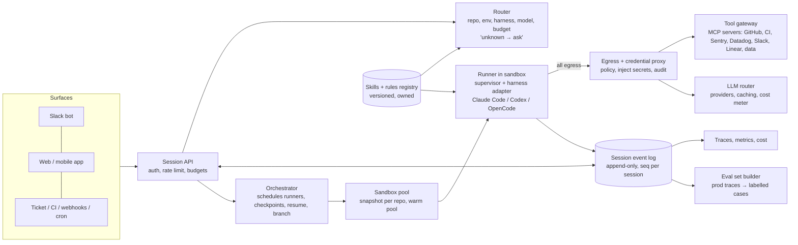
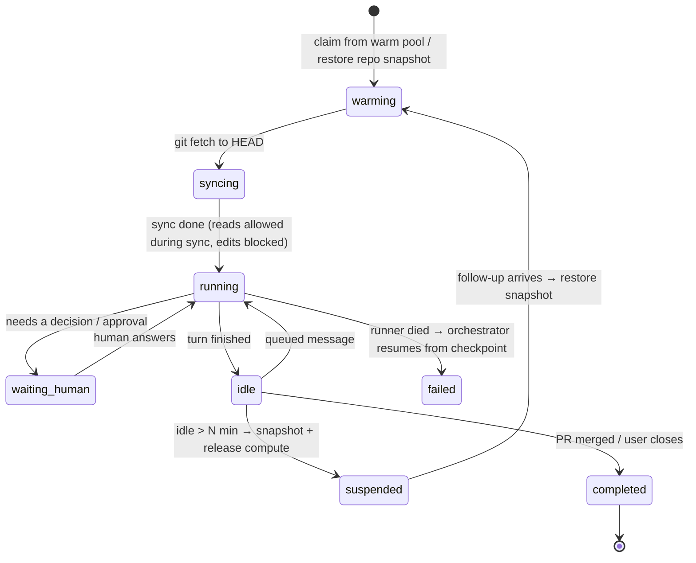
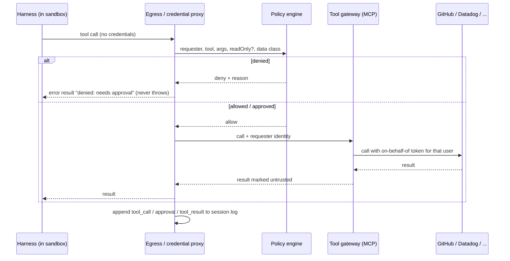

# Agent Engineer — conversational screen Q&A

> Weighting: **~70% internal agent platforms** (how companies actually run agents: Ramp Glass / Inspect, Sierra Pinecone,
> Stripe Minions, Spotify Honk), **~30% agent engineering craft** (loop, tools, MCP, evals, memory, safety).
> Answers are first-person spoken sentences. Rungs: 🟢 basic · 🟡 working · 🔴 senior (trade-off + failure mode + limit of the claim).

## Contents

| § | Section | Use it for |
|---|---|---|
| 1 | [Seven-layer model](#1-the-mental-model-an-internal-agent-platform-is-seven-layers) | Skeleton for any "how would you build this" |
| 2 | [Platform teardowns](#2-platform-teardowns) | Ramp, Sierra, Stripe, Spotify, Klarna, + Block, Airbnb, Anthropic, Uber, LinkedIn, Shopify |
| 3 | [Worked vs did not work](#3-worked-vs-did-not-work--the-pattern-table) | The pattern table |
| 4 | [Platform Q&A](#4-conversational-qa--platform-band-the-70) | Q1–Q15 |
| 5 | [Craft band](#5-craft-band-the-30--short-answers-deep-links) | C1–C4 + links to modules |
| 6–8 | Positioning, questions to ask, one-line drill | Opening and closing the call |
| 9 | [Senior design deep-dive](#9-senior-design-deep-dive-design-pinecone-for-us) | Whiteboard: APIs, event schema, sandbox lifecycle, gateway, cost, capacity |
| 10 | [Follow-up chains](#10-follow-up-chains-the-push-backs-a-senior-interviewer-asks) | The second and third "why" |
| 11 | [Failure scenarios](#11-failure-scenarios-incident-style) | "It's 2 a.m. and…" |
| 12 | [STAR stories](#12-star-stories-from-your-own-work) | Behavioural, tied to `agent-lab` |
| 13 | [Senior signals](#13-what-a-senior-answer-sounds-like) | Self-grading rubric |

## Read this first: what is verified and what is not

- **Researched on 2026-11-03.** Every platform fact below comes from the source linked next to it (see [Sources](#sources)). Almost all of
  it is **self-reported by the company** in a blog or talk. Say "Ramp says" / "Sierra wrote", never "Ramp has".
- **Numbers drift.** Ramp's Inspect share of merged PRs is ~30% in Ramp's own post (undated), "over half" in Modal's Feb 2026 case
  study, and "three in four" in a secondhand Linear story I could not open. Quote the one you can name, with its date.
- **Not confirmed by a primary source:** that Glass is built on the Claude Agent SDK (only a third-party explainer says so), and
  that Spotify Honk uses Claude Code / Agent SDK (Spotify's Part 1 does not name the harness). Do not state either as fact.
- **Your evidence** is in this repo: [`agent-lab/`](../../agent-lab/NOTES.md) (MCP agent, approval gate, audit, trajectory evals, mesh)
  and the craft modules under [`devrev-fde/modules/`](../devrev-fde/modules/README.md). Say "I built" only for that.

---

## 1. The mental model: an internal agent platform is seven layers

When they ask "how would you build Glass / Pinecone here", walk these layers top to bottom. Every real platform below maps onto them.

| # | Layer | Job | Ramp | Sierra Pinecone | Stripe Minions | Spotify Honk |
|---|---|---|---|---|---|---|
| 1 | **Surfaces** | Meet people where they already work | Slack, web, mobile, Chrome extension (Inspect); Glass app | Browser, Slack, Linear, phone | Slack thread tag, docs/flags/ticket UIs, CI "fix flaky test" button | Slack, GitHub Enterprise via MCP |
| 2 | **Router / intent classifier** | Pick repo, env, model, budget so users don't | Slack classifier picks repo (with an "unknown" option); Ramp Router picks model | Classifier picks repo, env, harness, model, reasoning budget | — (engineer scopes the task) | Interactive agent gathers requirements, hands a prompt to coding agent |
| 3 | **Session + durable state** | A unit of work that streams, survives crashes, can be shared | Cloudflare Durable Object per session, own SQLite, WebSocket stream | "Agency": K8s pod per runner, Redis Streams live, durable events + checkpoints; resume and branch | Web UI to watch a run | Logs to GCP, traces in MLflow |
| 4 | **Sandbox / environment** | Full dev env, isolated, fast to start | Modal sandbox, full stack (Postgres, Redis, Temporal, RabbitMQ), image rebuilt + snapshotted every 30 min | Pod with repo, warm build cache, sidecars, hot-reload servers, ~1 s setup | Pre-warmed devbox (~10 s), no prod, no internet | Fleet Management runs the change across repos |
| 5 | **Harness** | The agent loop itself | OpenCode (server-first, typed SDK, plugins) | Codex **and** Claude Code behind an AG-UI-based adapter | Fork of Block's Goose, agent steps interleaved with deterministic git/lint/test steps | Internal CLI that hides which agent/LLM is used |
| 6 | **Tools + knowledge** | What the agent can touch and know | Sentry, Datadog, LaunchDarkly, Braintrust, GitHub, Slack, Buildkite; Glass: Linear, Notion, Google, Slack, Gong + shared **Skills** | Slack, Linear, GitHub, email; **Skills** (private/shared/default), **Projects** with shared context; per-user MCP auth | **Toolshed**: one central MCP server, 400+ tools, small default subset per agent; shared rule files | Local MCP for format/lint |
| 7 | **Governance** | Creds, cost, review, audit, eval | GitHub App token per clone; PR opened with *user's* token so they can't self-approve; cost meter per project | Network proxy injects creds, agent never holds them; central cost team; no token leaderboards | Human review on every PR; max 2 CI rounds | LLM-as-judge on diffs; same PR review/merge pipeline |

**One line to say:** "Every one of these converged on the same shape: a cloud sandbox per session, one central tool gateway, a router
so users don't choose infra, durable sessions you can share, and the existing review pipeline as the safety net."

---

## 2. Platform teardowns

### 2.1 Ramp — Inspect (background coding agent) and Glass (AI workspace)

**Inspect, under the hood** (Ramp builders blog; Modal case study)
- Each session = a Modal sandbox VM with the full stack. Per-repo images rebuilt and snapshotted **every 30 minutes**, so code is at
  most 30 min stale. Sandbox is warmed **while the user is still typing**; the agent may *read* before git sync finishes, but an
  OpenCode plugin **blocks edits** until sync completes.
- State: one Cloudflare Durable Object per session with its own SQLite → sessions can't interfere; streaming over WebSockets.
- Git: GitHub App installation token per clone; commits carry the user's git config; the **API opens the PR with the user's own
  token** so the requester cannot approve their own change. Webhook tracks PR status.
- Verification: backend runs tests, reads telemetry, checks feature flags; frontend takes before/after screenshots, live previews,
  computer use in a streamed desktop.
- Multiplayer: many people in one session, every prompt attributed. Data model must not bind a session to one author.
- Follow-up prompts are **queued**, not injected mid-run; there is an explicit stop control.
- Chrome extension sends **DOM + React internals instead of screenshots** to save tokens; force-installed via device policy.
- Scale: passed **1 million sessions** (dbt Summit talk, write-up dated 2026-10-27).

**Glass** (Eric Glyman launch post, 2026-10-13; dbt Summit talk)
- Trigger: Ramp spent **$1.5M on tokens in one week in May 2026**. Glass is the answer to "everyone has tools, nobody shares what works".
- Core idea: "learn things once". Saved prompts/workflows become **Skills** that anyone starts from; sessions are multiplayer (a support
  agent pulls an engineer into her session to finish a ticket).
- Every request goes through **Ramp Router** (model selection); Ramp says moving onto it cut its own bill **30%**.
- Cost meter per project with limits set up front.
- Example: one account manager's saved skill took captured feature requests from ~300/month (hand-copied into Salesforce) to
  ~20,000/month. 323 employees had made 6,500+ edits to what Glass knows (as of launch).
- Pre-installed on new hires' laptops, pre-connected; spread organically, especially to sales and other non-engineers.
- Opened to outside companies in early access on 2026-10-13.

**Ramp's other pieces** (dbt talk): *Ramp Research* (data agent, query volume now exceeds human-written queries), *Rampplify*
(internal app hosting, ship and tear down fast), *WaveDash* (dashboards as SQL files in a repo → agents edit them like code; migrating
off Looker).

**What Ramp admits is not solved:** ROI measured by "black boxes and vibes"; AI-written docs bloating the wiki; legacy BI still in use.

### 2.2 Sierra — Pinecone (internal cloud agent)

Source: "Pinecone: harnessing the wisdom of the workforce", Allen Chen & Tess Rosania, 2026-07-15. (Not the vector DB company.)

- **Starting point (Jan 2026):** every engineer had Codex, Claude Code and Cursor on the laptop. Laptop agents didn't scale and
  improvements stayed with one person.
- **One agent, not many bots.** A classifier reads the prompt and picks repo, environment, harness, model and reasoning budget.
  Non-technical users could not answer "8 CPUs or 0.1?", so the platform stopped asking.
- **Architecture:** *App server* (UI, API, persistence, integrations, fan-out stream to every open tab) → *Agency* (reconciles each
  runner into a Kubernetes pod, Redis Streams for live traffic, durable events + checkpoints stored separately) → *Runner* (a Go
  supervisor process that runs Codex or Claude Code, manages dev services, brokers privileged operations).
- **Harness-agnostic:** both harnesses wrapped in one adapter on an **AG-UI**-based protocol → swap providers without touching UI.
- **Durable sessions:** a replacement runner resumes where the dead one stopped; sessions last hours or days; **branching** reuses
  the same checkpoint mechanism.
- **Security:** harness has limited network + filesystem. A **network proxy** approves/rejects each outbound call and **injects
  credentials**, so the agent never sees a real secret. "Assume it can do everything; trust nothing." Per-user MCP auth on branch.
- **Plugs in:** Slack, Linear, GitHub (opens PRs, watches CI, answers review comments, fixes failing tests, rebases, pings a human
  only when judgment is needed), email, webhooks/schedules, other internal tools (incident management, code review, Q&A bots) that
  create sessions; Skills; Projects (sessions share context and message each other); shareable live previews.
- **Numbers (self-reported, month before July 2026):** 600 people, 75,000+ sessions, 96% of engineering uses it, **70% of PRs opened
  through Pinecone**, usage tripled monthly since April while cost fell.
- **What worked:** cloud over laptops; **primitives over workflows** (workflows got rewritten every model upgrade, primitives —
  context, environments, company tools — held); meeting users in ChatGPT/Claude/Linear/GitHub; an enthusiast alpha cohort who became
  champions; central cost team; **no token leaderboards**.
- **What was hard:** "an agent is only as useful as the environment you give it" — per-role tools/data/permissions assembled on the
  fly without weakening security; no vendor fit, so they built it; harness misbehaviour (wrong config, missed AGENTS.md, wasteful
  approaches) — but because it's central, one fix lands for everyone. Same infra now powers *Ghostwriter*, their customer-facing builder.

### 2.3 Stripe — Minions (one-shot unattended coding agents)

Source: Alistair Gray, stripe.dev, Part 1 2026-02-09 (Part 2 2026-02-19).

- Unattended, one-shot: minions write all the code, humans review. **1,000+ merged PRs/week** (Part 1); Part 2 coverage says 1,300+.
- **Devbox** = the same machine engineers use, pre-warmed, ~10 s, isolated from prod and internet → no permission prompts needed.
- Harness: fork of Block's **Goose**, orchestration **interleaves agent steps with deterministic code** (git, lint, tests). This is
  the "blueprint" idea: don't let the LLM do what a script does reliably.
- **Toolshed:** one central MCP server, 400+ tools. Each agent gets a **small default subset**, not all 400. Before the run, relevant
  tools run deterministically over likely links to **pre-load context**.
- Rule files shared with Cursor / Claude Code, applied **per subdirectory**, not globally.
- Feedback: lint on every push (<5 s), CI on push with autofix, **max 2 CI rounds** (cost + diminishing returns), then hand to a human.
- Thesis: "if it's good for humans, it's good for LLMs". Shift feedback left.

### 2.4 Spotify — Honk (background agent inside Fleet Management)

Source: Charas & Bruggmann, Spotify Engineering, 2025-11-06 (Part 1 of 4).

- Fleet Management already applied changes across thousands of repos with **deterministic scripts**. Honk replaces only the
  *transformation* step with an agent. Targeting, PR creation, review, merge unchanged.
- Why: deterministic hit a wall — one Maven dependency updater grew past **20,000 lines** of edge cases.
- Internal CLI delegates to an agent, runs format/lint via local MCP, **LLM-as-judge on the diff**, logs to GCP, traces in MLflow.
  CLI hides which agent/LLM → they can switch.
- Reported: 1,500+ merged agent PRs, Fleet Management overall ~half of Spotify's PRs since mid-2024, 60–90% time saved on migrations.
- Open problems they name: slow, unpredictable output, guardrails/sandboxing, cost. Parts 2–3 cover context engineering and feedback loops.

### 2.5 The counter-example — Klarna customer service (what did not work)

- Feb 2024: Klarna said its assistant did the work of ~700 agents and handled ~2/3–3/4 of chats (company claim; figures vary by report).
- May 2025 (Bloomberg interview, widely re-reported): CEO said cost had been "a too predominant evaluation factor" and quality
  suffered; Klarna started hiring humans again for a hybrid model.
- **Lesson to say:** optimise a customer-facing agent on cost/deflection alone and quality falls; you need a quality metric and an
  easy path to a human from day one. Contrast: the internal platforms above keep the human review step and measure merged work.

### 2.6 Block — Goose rolled out company-wide with bundled MCP servers

Source: Angie Jones, "MCP in the Enterprise: Real World Adoption at Block", goose blog, 2025-04-21 (primary).

- **Shape:** not a cloud platform — a **local** agent (CLI + desktop) **pre-installed** on every laptop, with a curated set of
  approved MCP servers bundled by default and models auto-configured. Thousands of employees use it daily (per the post).
- **All internal MCP servers are written by Block engineers.** Most used: Snowflake, GitHub, Jira, Slack, Google Drive, internal
  compliance and support-triage APIs.
- **Security:** MCP config decides **which models may invoke which tools**; tools labelled **read-only vs destructive**, destructive
  ones can require confirmation; some servers enforce an **LLM allowlist** or limit sharing tool output across systems; certain
  sensitive-data categories are off-limits; OAuth with tokens in the OS keychain.
- **Models:** hosted on Databricks → Claude and OpenAI through enterprise endpoints (data-usage protections in the contracts).
- **Worked:** lowering the barrier (pre-installed, bundled, auto-configured) drove adoption most; weekly DevRel sessions; people
  remixing each other's prompts.
- **Admitted gap:** OAuth runs *inside locally-run MCP servers* — "practical but temporary"; they want decoupled auth, context-based
  tool restrictions, and more human-in-the-loop for risky ops. Reported 50–75% time saved on common tasks is self-reported.
- **Contrast to say:** Block is the *local-first* answer; Sierra explicitly moved *off* laptops. Local wins on time-to-adoption,
  cloud wins on sharing, central fixes and governance.

### 2.7 Airbnb — LLM-driven test migration (a pipeline, not an agent platform)

Source: Charles Covey-Brandt, "Accelerating Large-Scale Test Migration with LLMs", Airbnb Tech blog (primary; ~early 2025).

- ~3.5K React test files, Enzyme → React Testing Library. Manual estimate **~1.5 years**; done in **~6 weeks**.
- **Per-file state machine:** Enzyme refactor → fix Jest → fix lint + tsc → mark complete. A file only advances when that step's
  **validation** passes; on failure the errors + latest file go back to the model. Steps tracked per file → rerun one file or one
  step, parallelise hundreds.
- **Context, not prompt polish:** prompts grew to 40K–100K tokens with up to ~50 related files (component source, sibling tests,
  RTL examples, guidelines). The post says choosing the right related files mattered more than prompt wording.
- **Long tail:** "sample, tune, sweep" — sample 5–10 failing files, tune, rerun, sweep the rest; breadth-first on common failures.
  75% in the first 4-hour bulk run, 97% after ~4 days of tuning; the last ~3% finished by hand.
- **Why it matters for you (front-end architect):** this is the cleanest public example of *validation-gated retry loops*. Same idea
  as Stripe's lint/CI gates and Spotify's judge — the verifier, not the model, decides "done".

### 2.8 Anthropic — how its own teams use Claude Code

Source: "How Anthropic teams use Claude Code" report, 2025-07-24 (primary PDF / case study).

- Covers engineering **and** non-engineering teams (security, data infra, legal, marketing, product). Patterns: codebase
  onboarding, routine data-engineering automation, infra troubleshooting, documented reusable workflows.
- A separate figure — Claude Code's own team landing ~65% of its PRs through an internal agent — comes from a **conference talk via
  secondary coverage**; I have not verified it. Don't quote it.

### 2.9 Uber, LinkedIn, Shopify — secondary sources only, use as "I've read that…"

- **Uber:** a LangGraph-based developer-tools platform with an internal wrapper framework; *Validator* (IDE agent), *uReview*
  (code review: one model generates comments, a second grades them before posting), *Genie* (on-call Slack copilot, agentic RAG).
  Figures I saw (diff coverage, hours saved) are from aggregators — **unverified**.
- **LinkedIn — Hiring Assistant:** described as plan-and-execute (not ReAct), a supervisor with sub-agents for intake, sourcing,
  evaluation, outreach, screening, on a message-driven agent lifecycle platform, built on LangGraph. **Unverified** beyond summaries.
- **Shopify:** a central **LLM proxy** every request goes through, an internal MCP layer for non-engineers, and **Roast**, an
  open-source Ruby framework for structured AI workflows (each step can use a different provider). **Verify** on Shopify's blog / the
  Roast repo before quoting.
- **Pattern across all three:** a central gateway (LLM proxy / MCP gateway), and a generator-plus-grader split for quality.

| Company | Local or cloud | Central gateway | Verifier | Source strength |
|---|---|---|---|---|
| Ramp Inspect | Cloud (Modal) | GitHub App + tools | Tests, telemetry, screenshots, PR review | Primary |
| Sierra Pinecone | Cloud (K8s) | Credential proxy + per-user MCP | CI watch, PR review | Primary |
| Stripe Minions | Cloud devbox | Toolshed MCP | Lint + ≤2 CI rounds + review | Primary |
| Spotify Honk | Fleet pipeline | Local MCP | LLM judge + PR review | Primary |
| Block Goose | **Local** | Bundled, allowlisted MCP | Confirm destructive tools | Primary |
| Airbnb migration | Batch pipeline | — | Jest + lint + tsc gates | Primary |
| Uber / LinkedIn / Shopify | Mixed | LLM proxy / gateway | Grader model | Secondary |

---

## 3. Worked vs did not work — the pattern table

| Worked (seen in 2+ platforms) | Did not work / still open |
|---|---|
| Cloud sandbox per session, not laptop agents (Ramp, Sierra, Stripe) | Laptop-only agents: no sharing, no central fix, no governance (Sierra) |
| Pre-warmed / snapshotted envs: seconds to start (Ramp 30-min snapshots, Sierra ~1 s, Stripe ~10 s) | Making users choose CPU / repo / model (Sierra) |
| Router/classifier picks repo, model, budget (Ramp, Sierra) | Many single-purpose bots → consolidated into one agent (Sierra) |
| One central tool gateway (Stripe Toolshed, Sierra proxy/MCP) with **small default tool sets** | Hand-built workflows → rewritten every model upgrade; build primitives instead (Sierra) |
| Credentials injected by a proxy / scoped tokens, never in the agent (Sierra, Ramp) | ROI measurement: "black boxes and vibes" (Ramp) |
| Reuse the existing human PR review + CI as the safety net (all four) | Token spend explosion without a meter ($1.5M/week, Ramp) |
| Deterministic steps interleaved with agent steps (Stripe, Spotify) | Unbounded CI retry loops → cap at 2 (Stripe) |
| Shared Skills / rule files so one person's win becomes the default (Ramp, Sierra, Stripe) | AI-written doc bloat (Ramp) |
| Multiplayer, shareable sessions (Ramp, Sierra) | Cost-only success metric on customer-facing agents (Klarna) |
| Harness/model-agnostic adapter (Sierra AG-UI, Spotify CLI, Ramp Router) | Single-vendor lock-in (explicitly avoided by Ramp) |
| Organic adoption via a champion cohort, not a mandate (Ramp, Sierra) | Leaderboards of token usage (Sierra avoids them) |
| Pre-installed + pre-connected on day one (Block, Ramp Glass) | OAuth inside local MCP servers — "temporary" (Block) |
| Validation-gated retry loops; verifier decides "done" (Airbnb, Stripe, Spotify) | Prompt polish as the main lever — context selection mattered more (Airbnb) |
| Read-only vs destructive tool labels; confirm destructive (Block, your agent-lab) | Chasing the hardest long-tail cases first — go breadth-first (Airbnb) |

---

## 4. Conversational Q&A — platform band (the 70%)

### 🟢 Q1. "What is an internal agent platform, and why do companies build one instead of giving everyone Cursor?"
**A:** An internal agent platform is the shared layer that runs agents in the cloud for the whole company: a sandbox per task, a
central set of tools with the right credentials, a router that picks model and environment, and sessions people can watch and share.
Companies build it because laptop tools give you individual speed but no compounding. Sierra wrote exactly this: in January every
engineer had Codex, Claude Code and Cursor, but improvements stayed with one person. Once the agent runs centrally, one fix to the
harness or one good skill lands for everyone, cost is visible, and security can enforce one policy at one choke point.

### 🟢 Q2. "Walk me through what happens when someone at Ramp asks Inspect for a change in Slack."
**A:** A fast classifier reads the message, the thread and the channel name and picks the repo, with an explicit "unknown" option so
it can ask instead of guessing. The platform starts a Modal sandbox from a snapshot of that repo that is at most thirty minutes old,
and it starts warming while the person is still typing. The agent, OpenCode, can read files immediately but a plugin blocks edits until
git sync finishes, so it never edits stale code. Session state lives in a Durable Object with its own SQLite and streams to Slack and
the web UI. The agent runs tests, checks telemetry and flags, takes screenshots for UI work, pushes a branch, and then the API opens
the PR with the requester's own GitHub token, so they cannot approve their own change. Normal review and CI do the rest.

### 🟡 Q3. "Pinecone and Glass both claim to 'capture the wisdom of the workforce'. What does that actually mean technically?"
**A:** Three concrete mechanisms. First, **Skills**: a saved, versioned prompt-plus-tools playbook that can be private, shared, or on
by default; Ramp's example is one account manager's feature-request skill going from about 300 to about 20,000 captured requests a
month. Second, **shared sessions and projects**: sessions are readable and joinable, and in Pinecone sessions in a project share
searchable context and can message each other. Third, **central harness fixes**: because every run is in one platform, the team sees
misbehaviour like missed AGENTS.md files and fixes it once. The honest limit: none of the posts show a measurement that the captured
knowledge stays correct over time; Ramp itself complains about AI-generated doc bloat. I'd want ownership and expiry on skills.

### 🟡 Q4. "Why did Sierra go to one agent with a classifier instead of a menu of specialised bots?"
**A:** Because users were bad at picking, and the bots fragmented knowledge. Non-technical people couldn't say whether a task needed
eight CPUs or a tenth of one, or which repo it lived in. A classifier choosing repo, environment, harness, model and reasoning budget
moves that decision to the platform, where it can be measured and tuned. The trade-off is that a wrong route is now invisible to the
user, so the classifier needs an "unknown, ask me" path like Ramp's, logging of every route decision, and an eval set of real prompts
labelled with the right route.

### 🟡 Q5. "How do these platforms handle credentials and permissions?"
**A:** The pattern is: the agent never holds a real secret. Sierra runs the harness with limited network and filesystem and sends
every outbound call through a proxy that approves or rejects it and injects the credential. Ramp mints a GitHub App installation token
per clone and opens PRs with the user's token. Stripe goes the other way on isolation: devboxes have no prod and no internet, so the
agent can run without permission prompts. The principle I'd state is "assume it can do everything, trust nothing": scope by
environment and by a proxy, not by asking the model to behave. The open question is per-user identity — the agent should act with the
requester's permissions, not a superuser service account, and Sierra mentions per-user MCP authorization for that.

### 🟡 Q6. "What is Stripe's Toolshed and why does 'small default tool set' matter?"
**A:** Toolshed is Stripe's single central MCP server with over 400 tools for internal systems and SaaS. The important detail is that a
minion does not get all 400: it gets a small default subset and can request more. Every tool definition costs context tokens and adds
a wrong choice the model can make, so tool selection accuracy drops as the list grows. Stripe also runs some tools deterministically
before the agent starts, to pre-load context from links in the task. So the gateway centralises auth, audit and ownership, and
per-task curation keeps the model's choice small.

### 🟡 Q7. "Why interleave deterministic steps with agent steps?"
**A:** Because git operations, lint and test runs have one right way to do them, and an LLM doing them adds cost and a failure mode for
nothing. Stripe's harness runs those as code between agent steps; Spotify kept targeting, PR creation, review and merge deterministic
and swapped only the transformation step for an agent. The rule I use: the LLM decides, code executes anything with a fixed procedure.
It also makes runs easier to test, because the deterministic parts have normal unit tests.

### 🔴 Q8. "Design an internal agent platform for a 1,000-person company. Where do you start?"
**A:** I start with one high-volume job that already has a review gate, because that gives me a safety net and a metric. Background
coding PRs are the obvious one: success is "merged without human-written code", and the existing PR review catches mistakes. Then I
build the seven layers thinly: Slack plus web as surfaces; a classifier for repo and model with an "unknown" path; a session service
with durable, append-only events so a crashed runner resumes and sessions can be shared; snapshotted sandboxes so start is seconds;
a harness behind an adapter so I can swap Claude Code, Codex or OpenCode; one tool gateway over MCP with per-user scoped auth and a
credential-injecting proxy; and governance from day one — per-project cost meter, a cap on CI rounds, audit of every tool call. I'd
grow through a champion cohort, not a mandate. Failure modes I'd plan for: snapshot staleness causing bad diffs, token spend
explosion, and skills rotting. The limit: everything I know of this shape is from company blogs, which report wins, not failures.

### 🔴 Q9. "How would you measure whether the platform is worth it?"
**A:** Ramp's data engineer said they measure ROI by "black boxes and vibes", so this is genuinely unsolved and I'd say that. I'd
separate output from outcome. Output: sessions, merged PRs per week with no human-written code (Stripe's metric), share of PRs opened
through the platform (Sierra's 70%), time-to-first-diff. Quality: revert rate and follow-up-fix rate of agent PRs versus human PRs,
review time per PR, CI rounds per task. Cost: tokens and compute per merged PR, which is the number that catches a $1.5M week early.
And for non-code work like Glass skills, adoption of a skill by people other than its author. I would not use token usage as a
leaderboard — Sierra explicitly avoids that because it rewards waste.

### 🔴 Q10. "What breaks first when this scales from 50 to 600 users?"
**A:** Three things, from the posts and from general distributed-systems sense. Cost: usage tripled monthly at Sierra, and Ramp had a
$1.5M token week, so you need routing to cheaper models and hard per-project limits. Environments: every new team needs different
tools, data and permissions, and Sierra calls this the hard part. And review load: if agents open 70% of PRs, human reviewers become the
bottleneck, which is why Pinecone answers review comments and fixes CI itself and only pings a human for judgment. Session durability
also matters more: long sessions on preemptible pods need checkpoint-and-resume, which Sierra built into Agency.

### 🔴 Q11. "Build vs buy — Devin, Cursor background agents, Codex cloud. Why did Ramp and Sierra build?"
**A:** Both say no vendor met their requirements, and Ramp's argument is that owning the tooling lets the agent have the same context
and tools as an engineer — Sentry, Datadog, LaunchDarkly, Buildkite — which a vendor can't wire for you. Both also deliberately stay
model- and harness-agnostic. My honest view: building makes sense when you have a platform team, a large codebase, and internal tools a
vendor can't reach; for a small team, buy the harness and build only the tool gateway and the environment snapshots, because those are
where the company-specific value is. Note that Sierra and Ramp both built on top of existing harnesses — Codex, Claude Code, OpenCode —
they did not write their own agent loop.

### 🔴 Q12. "What would you not let an internal agent do?"
**A:** Anything irreversible outside a review gate: merge its own PR, deploy to prod, send external email or payments, or change
permissions. Ramp enforces the first structurally by opening PRs with the requester's token. Stripe enforces isolation by giving devboxes
no prod and no internet. Everything that reads untrusted content — Slack threads, tickets, web pages — is a prompt-injection channel, so
the agent's write tools should be gated by policy at the proxy, not by the prompt. In my agent-lab the write tools go through an approval
gate that defaults to deny, and every call is audited.

### 🟡 Q13. "Why do sessions need to be durable and multiplayer?"
**A:** Durable because agent runs last minutes to days and pods die; Sierra records every event so a replacement runner resumes and the
same checkpoints give you branching for free. Multiplayer because the value is in handoffs: a support person starts a session, pulls in an
engineer, and the engineer sees the full context instead of a summary. Ramp's design note is that the data model must not tie a session to
one author and every prompt must be attributed. And follow-up prompts should queue rather than interrupt a running step.

### 🟡 Q14. "How do non-engineers use these platforms?"
**A:** Mostly through Skills and Slack, not code. Ramp's Glass spread to sales and account managers: one saved skill pulls feature requests
from Gong calls, another emails customers when the feature ships. Sierra's automations scan email and Slack each morning and produce
action-item lists. Ramp's Chrome extension lets people describe UI changes on a live React app. The platform's job is to hide infra choices
and keep a cost meter visible.

### 🔴 Q15. "What's the failure story you'd watch for in a customer-facing agent versus an internal one?"
**A:** Internal agents have a human reviewer and an existing pipeline behind them, so a bad output costs review time. A customer-facing
agent's bad output reaches the customer directly. Klarna is the public example: they optimised for cost, quality fell, and in 2025 the CEO
said cost had been too dominant a factor and they began hiring humans back. So for customer-facing agents I'd require a quality metric
alongside deflection, policy-following tests — Sierra's τ-bench measures that and introduced pass^k, which is all k runs succeeding — and a
cheap path to a human.

---

## 5. Craft band (the 30%) — short answers, deep links

| Topic | Say this | Deep dive in this repo |
|---|---|---|
| Agent loop | "A loop: model proposes a tool call, code validates args against the schema, executes with a timeout, returns a result the model can read even on error, repeat until final answer or max steps." | [03-agents-and-mcp](../devrev-fde/modules/03-agents-and-mcp.md) Phase 3–4, `agent-lab/agent/loop.py` |
| Tool design | "Tool descriptions are prompts. Fewer, well-named tools with typed args beat many overlapping ones — Stripe gives a small default set out of 400." | 03 Phase 1 |
| MCP | "A protocol so tools are written once and any harness can call them; it moves auth, audit and ownership to a server. It doesn't solve tool selection or permissions by itself." | 03 Phase 2, `agent-lab/mcp_server/` |
| Safety | "Default-deny write tools, approval gate, grounded-argument check, treat tool output as untrusted data, enforce at the proxy not the prompt." | 03 Phase 5, `agent-lab/agent/approval.py`, `grounding.py` |
| Evals | "Grade the trajectory — which tools, which args, what changed — not just the final text. Golden + held-out cases, pass@k for capability, pass^k for reliability." | [llm-eval-and-observability](../llm-eval-and-observability/README.md), `agent-lab/evals/` |
| Context & memory | "Context is a budget. Pre-load what's deterministic, retrieve the rest, compact long sessions, keep long-term memory as explicit, owned records." | [10-agent-memory-and-context](../devrev-fde/modules/10-agent-memory-and-context.md) |
| Multi-agent / durable | "Prefer one agent with good tools; split only when contexts truly differ. Durable execution means checkpointed steps and idempotent writes." | [11-multi-agent-orchestration](../devrev-fde/modules/11-multi-agent-orchestration-and-durable-execution.md) |
| Prompt lifecycle | "Prompts are versioned artifacts with evals in CI, canary by percentage, stop on any safety failure." | [12-prompt-versioning](../devrev-fde/modules/12-prompt-versioning-and-agent-lifecycle.md) |
| Agent services | "Agents as HTTP services with signed envelopes and a leased queue; not the A2A protocol." | [14-agent-deployment](../devrev-fde/modules/14-agent-deployment-and-inter-agent-communication.md), `agent-lab/mesh/` |
| Frontend for agents | "Stream events, show tool calls and diffs, let users interrupt, queue follow-ups." | [09-frontend-ai-ui](../devrev-fde/modules/09-frontend-ai-ui.md), `fe-hands-on/app/agent-console-ui` |

### 🟡 C1. "Your agent works in the demo and fails 30% in production. What do you do?"
**A:** I stop changing prompts and build the eval first. I pull real failing traces, label what the right trajectory was, and turn them
into cases next to the passing ones. Then I classify failures: wrong tool, wrong args, missing context, or the environment lied. Most
production failures in my experience and in these blogs are context and environment, not model — Sierra's "an agent is only as useful as
the environment you give it". I fix the biggest bucket, re-run the whole set including held-out cases, and only ship when it doesn't
regress. In agent-lab I did exactly this for two live failures and kept four held-out cases to catch over-fitting.

### 🔴 C2. "Pass@k vs pass^k — which one do you report?"
**A:** Pass@k is "at least one of k tries succeeds" — a capability ceiling, fine when a human picks the best. Pass^k is "all k succeed" —
reliability, which is what an unattended agent needs. Sierra's τ-bench introduced pass^k because agents that look fine on one try fall
apart on repeats. For an internal background agent with review, I'd report pass^1 and pass^3; for customer-facing, pass^k with k at least 4.

### 🔴 C3. "How do you keep an agent from looping and burning tokens?"
**A:** Hard caps owned by code, not the model: max steps, max CI rounds — Stripe uses two — a token budget per session, and a wall-clock
timeout. Plus a cost meter the user can see, like Glass. And detect repeated identical tool calls and stop with a clear message.

### 🟡 C4. "Prompt injection through a Slack thread or ticket — how do you defend?"
**A:** You can't make the model immune, so limit what an injected instruction can do. Mark tool output as untrusted data, keep write tools
behind approval or a policy proxy, scope credentials to the requester, isolate the sandbox network like Stripe's devboxes, and require a
grounded argument — a write's target must come from the user's request, not from retrieved text. That last one is in agent-lab's
`grounding.py`.

---

## 6. Your positioning (say it in 60 seconds)

"I'm a front-end and platform architect with ten-plus years, now focused on agents. I've built an MCP-based agent with an approval gate,
audit log and a trajectory eval harness, and agent services that talk over signed envelopes. What draws me to agent engineering is the
platform shape the strongest teams converged on — Ramp's Inspect and Glass, Sierra's Pinecone, Stripe's Minions: cloud sandboxes, one tool
gateway, a router, durable shareable sessions. That's distributed systems plus UX, which is where I've spent my career. The UI half —
streaming sessions, multiplayer, letting people interrupt and review — is exactly the front-end work most agent teams under-invest in."

**Honest gaps (say them before they find them):** I have not run an agent platform for hundreds of users; my evals are small-n on one
model; I haven't operated Modal or Durable Objects in production — I know them from the published designs.

---

## 7. Questions to ask them

1. "Which job did your platform win first, and what is the success metric for it — merged PRs, sessions, something else?"
2. "Is the agent acting with the requester's identity or a service account? Where is policy enforced?"
3. "How do you decide which harness and model run a task — router, user choice, or fixed?"
4. "What's your current biggest failure bucket: environment, context, tool selection, or review load?"
5. "How do you keep shared skills or rules from going stale?"
6. "How do you measure ROI today?" (Ramp's own answer was "vibes" — listen for whether they have better.)

---

## 8. Drill: one-line answers (cover the right column)

| Prompt | One line |
|---|---|
| Why cloud, not laptop agents? | Sharing, central fixes, governance, cost visibility. |
| Snapshot every 30 min — why? | Seconds to start; at most 30 min stale; edits blocked until sync. |
| PR with requester's token — why? | So nobody approves their own agent's change. |
| Credential proxy — why? | The agent never sees a secret; policy at one choke point. |
| Small tool subsets — why? | Context cost and selection accuracy degrade with tool count. |
| Cap CI rounds at 2 — why? | Diminishing returns; cost and time. |
| Primitives over workflows — why? | Workflows get rewritten every model upgrade; context, envs and tools last. |
| Harness adapter — why? | Swap Codex / Claude Code / OpenCode without touching the product. |
| What's unsolved? | ROI measurement, review load, skill rot, cost spikes. |

---

## 9. Senior design deep-dive: "Design Pinecone for us"

> This is the 45-minute version of Q8. Everything here is **my design**, informed by §2. Numbers are **assumptions** I state
> out loud, not facts about any company. Code blocks are **illustrative (not from the repo)**.

### 9.0 Ask before drawing (the senior signal)

1. "Who are the users — engineers only, or sales and support too?" → decides whether Skills and Slack matter more than an IDE.
2. "What's the first job — background PRs, data questions, ticket triage?" → decides the verifier.
3. "Do agents need prod data or prod write access?" → decides isolation model.
4. "Build the harness or reuse Claude Code / Codex / OpenCode?" → nearly always reuse; build the platform around it.
5. "Single region? Data residency?" → decides where sandboxes and logs live.
6. "What does success look like in 90 days?" → the metric I'll design the telemetry for.

### 9.1 Requirements

**Functional:** start a session from Slack / web / ticket / webhook / schedule; stream progress (text, tool calls, diffs,
screenshots); interrupt, queue follow-ups, branch, share, join; open PRs and react to CI and review comments; save and share Skills;
per-project cost meter.

**Non-functional:**

| Property | Target I'd propose | Why |
|---|---|---|
| Time to first agent action | < 5 s p50 | Ramp warms while typing; Sierra ~1 s; Stripe ~10 s |
| Session durability | Survive runner death; resume from last checkpoint | Sessions run hours/days (Sierra) |
| Isolation | One sandbox per session; no prod; egress allowlist | Blast radius of an injected instruction |
| Secrets | Never inside the sandbox | Proxy injects (Sierra) |
| Auditability | Every tool call attributable to a human requester | Security + compliance review |
| Cost | Hard budget per project and per session | $1.5M/week failure mode (Ramp) |
| Provider independence | Swap harness/model per task | Lock-in avoidance (Ramp, Sierra) |

### 9.2 Back-of-envelope (assumptions, say them aloud)

- 1,000 employees, ~60% weekly active → **600 users** (same order as Sierra's reported 600).
- **75,000 sessions/month** (Sierra's reported figure, used as a planning anchor) ÷ ~22 working days ≈ **3,400/day**.
- Spread over a 10-hour day ≈ 340/h average; assume **3× peak** ≈ **1,000 sessions/hour**.
- Average active session **20 minutes**. Little's law (concurrency = arrival rate × time in system): 1,000/h × ⅓ h ≈ **~330
  concurrent sandboxes at peak**.
- At 2 vCPU / 8 GB each → **~660 vCPU, ~2.6 TB RAM** at peak; most of the day well under half that → autoscale + suspend idle.
- Tokens: assume **~200K tokens per session** including repeated context → 75K × 200K = **~15B tokens/month**. Multiply by your
  blended per-token price; prompt caching and routing to smaller models move this by a large factor, so cost is a design input.
- Event log: ~500 events × ~2 KB ≈ **1 MB/session** → **~75 GB/month** raw. Cheap; keep it, it's your audit and eval source.

**Conclusion to say:** "Compute is a few hundred sandboxes at peak — an autoscaling problem, not a hard one. Tokens are the cost that
can explode, and review load is the human bottleneck. So I design around cost control and verification, not raw scale."

### 9.3 Architecture



**Control flow in one breath:** a surface posts a message → Session API checks auth and budget, appends `user_message` → Router
picks target (or asks) → Orchestrator claims a warm sandbox from that repo's snapshot → Runner starts the harness → every model and
tool call leaves the sandbox only through the proxy → every step is appended to the log → surfaces tail the log → on completion the
platform (not the sandbox) opens the PR with the requester's identity → CI and review webhooks re-enter as new events.

**Data flow:** the event log is the single source of truth. UI state, audit, cost, resume, branch and evals are all projections of it.

### 9.4 API surface (illustrative)

| Method | Path | Notes |
|---|---|---|
| `POST` | `/sessions` | body: prompt, surface, optional repo/skill hint; returns `sessionId`; `Idempotency-Key` header so a Slack retry doesn't double-start |
| `GET` | `/sessions/{id}/events?after={seq}` | SSE stream; reconnect resumes from last seq |
| `POST` | `/sessions/{id}/messages` | **queued** follow-up, never injected mid-step |
| `POST` | `/sessions/{id}/interrupt` | stop after current tool call returns |
| `POST` | `/sessions/{id}/branch` | `fromSeq`; new session from that checkpoint |
| `POST` | `/sessions/{id}/participants` | add a teammate; prompts stay attributed |
| `POST` | `/skills` · `GET /skills?scope=` | versioned; owner; scope private / team / default |
| `POST` | `/hooks/{provider}` | GitHub, CI, Linear → new events on the session that owns the PR/ticket |

```ts
type SessionEvent =
  | { seq: number; type: "user_message"; authorId: string; text: string }
  | { seq: number; type: "route_decision"; repo: string | "unknown"; harness: string; model: string; confidence: number }
  | { seq: number; type: "tool_call"; callId: string; tool: string; args: unknown; readOnly: boolean }
  | { seq: number; type: "approval"; callId: string; decision: "allow" | "deny"; by: "policy" | string }
  | { seq: number; type: "tool_result"; callId: string; ok: boolean; untrusted: boolean; bytes: number }
  | { seq: number; type: "model_delta"; text: string }
  | { seq: number; type: "diff"; files: string[]; patchRef: string }
  | { seq: number; type: "checkpoint"; snapshotRef: string }
  | { seq: number; type: "cost"; inputTokens: number; outputTokens: number; cachedTokens: number; usd: number }
  | { seq: number; type: "status"; state: SessionState; reason?: string };

type SessionState =
  | "requested" | "warming" | "syncing" | "running" | "waiting_human"
  | "idle" | "suspended" | "completed" | "failed" | "cancelled";
```

**Why event-sourced:** resume = replay to last checkpoint; branch = new log from `fromSeq`; multiplayer = many tails of one log;
audit = the log; evals = labelled slices of the log. One write path, many read models.

### 9.5 Sandbox lifecycle



- **Snapshot freshness vs cost:** rebuild per-repo images every 30 min (Ramp's number) for hot repos, on-demand for cold ones.
- **Warm pool** sized from the peak concurrency estimate per hot repo; cold repos pay a slower start.
- **Suspend on idle** is the biggest compute saver: most wall-clock time in a session is a human not replying.

### 9.6 Tool gateway and credential proxy



- **Identity:** the agent acts **as the requester** (on-behalf-of token), never a superuser service account. A user can't do through
  the agent what they couldn't do themselves.
- **Tool curation:** each route gets a **small default tool set** (Stripe); more tools on request, logged.
- **Read-only vs destructive** labels on every tool (Block); destructive → approval or policy, enforced at the proxy, not in the prompt.
- **Results are untrusted data** (your agent-lab marks them `untrusted`); identifiers in write args must be **grounded** in the user's
  request or an earlier successful result.

### 9.7 Router

- Inputs: message, thread, channel, linked ticket/PR, user's team, recent sessions.
- Outputs: repo, environment size, harness, model tier, reasoning budget, default tool set, skills to load — or **`unknown → ask`**.
- Start with a **small fast model + rules** (channel → repo map); log every decision with confidence; build a labelled set from
  corrections ("no, it's the billing repo"). Measure misroute rate weekly.
- Below a confidence threshold, ask one clarifying question. A wrong repo costs a whole session; a question costs seconds.

### 9.8 Cost control (layered, all enforced in code)

| Layer | Control |
|---|---|
| Org / project | Monthly budget, alert at 50/80%, hard stop at 100% with override by owner |
| Session | Token + wall-clock budget from the router's tier; visible meter in the UI (Glass) |
| Loop | Max steps, max CI rounds (Stripe: 2), repeated-identical-call detector |
| Model | Route easy work to cheaper models; prompt caching for repo context and skill text |
| Compute | Suspend idle sandboxes; warm pools only for hot repos |
| Culture | No token leaderboards (Sierra) — publish cost **per merged PR**, not tokens per person |

### 9.9 Observability and the eval loop

- **Trace per session** (one span per model call and tool call, linked by `sessionId` / `callId`). OpenTelemetry has GenAI semantic
  conventions for this — *verify their current status in the OTel docs before naming attributes*.
- **Golden signals for the platform:** time to first action, sessions/day, success (merged / resolved), revert rate, CI rounds per
  task, misroute rate, cost per success, `waiting_human` time, tool error rate per tool.
- **Eval loop:** sample production sessions → label trajectory (right tool, right args, right outcome) → add to the case set →
  every change to harness version, system prompt, default skill or tool description runs the set in CI → canary by % of sessions →
  stop on any safety failure. Same rules as [12-prompt-versioning](../devrev-fde/modules/12-prompt-versioning-and-agent-lifecycle.md).
- Report **pass^k** for unattended routes (reliability), pass@k only where a human picks.

### 9.10 The front-end half (your edge — say this)

- **Transport:** SSE for the event tail (one-way, HTTP, auto-reconnect, `Last-Event-ID` = last `seq`); a POST for messages. WebSocket
  only if you need low-latency bidirectional (live cursor/presence). Ramp uses WebSockets via Durable Objects; both work.
- **Resume without gaps:** client keeps `lastSeq`; reconnect asks `after=lastSeq`; events are idempotent by `seq`.
- **Render model:** UI is a reducer over events — the same projection the server uses, so replay and live look identical.
- **Big outputs:** stream diffs as refs, fetch patch on expand; virtualise long transcripts; collapse tool-call noise by default.
- **Control affordances:** interrupt, queue follow-up (show as pending), approve/deny inline, branch from any event, share link.
- **Multiplayer:** presence, per-prompt attribution, one session many viewers; conflict-free because writes are appends.
- **Accessibility:** live region for status changes, not for every token.

### 9.11 Trade-offs to volunteer

| Decision | Option A | Option B | My pick and why |
|---|---|---|---|
| Where agents run | Local (Block) | Cloud (Sierra, Ramp, Stripe) | Cloud for background work — sharing, central fixes, governance; keep local IDE agents for interactive coding |
| Agent topology | Many specialised bots | One agent + router (Sierra) | One agent; specialise by skills and tool sets, not by bot |
| Harness | Build own loop | Reuse Claude Code / Codex / OpenCode behind an adapter | Reuse; value is in env, tools, governance |
| Session state | Durable Objects per session (Ramp) | K8s + Redis Streams + durable store (Sierra) | Either; pick what the team operates. Requirement is append-only log + checkpoint |
| Snapshot cadence | Fresh per session | Periodic (30 min) + sync | Periodic + block edits until sync |
| Who opens the PR | Sandbox with bot token | Platform with requester's token (Ramp) | Platform — no self-approval, no token in sandbox |
| Gate placement | Prompt says "don't" | Proxy enforces policy | Proxy; prompts are hints |

### 9.12 Rollout

1. **Weeks 0–4:** one route (background PRs on one hot repo), Slack + web, 10–20 champions, existing PR review as the gate.
2. **Weeks 4–8:** event-log-driven metrics and cost meter; first 50 labelled eval cases from real sessions; second and third repo.
3. **Weeks 8–12:** Skills registry with owners; PR babysitting (CI fixes, review comments); open to all engineering.
4. **Then:** non-engineering routes (data questions, ticket triage) once per-user identity on data tools is solid.

**What I'd cut from v1:** branching, Chrome extension, multi-agent projects, custom harness. Keep: durable log, proxy, budgets.

---

## 10. Follow-up chains: the push-backs a senior interviewer asks

**Q1 (why a platform)**
- *"Isn't this just Cursor background agents with extra steps?"* → For one engineer, yes. The platform's value is the company-specific
  part a vendor can't do: your env snapshots, your tool gateway with your identities, your skills, your cost and audit.
- *"When would you not build one?"* → Small company, no platform team, few internal tools. Buy the harness, maybe build a tool gateway.

**Q2 (Inspect flow)**
- *"Why let it read before sync finishes?"* → Reading stale files is cheap and the agent can plan; editing stale files creates
  conflicts. So reads are allowed, edits block.
- *"Why queue follow-ups?"* → Injecting mid-step changes the context under a running tool call; queuing keeps each step coherent.

**Q3 (wisdom of the workforce)**
- *"How do you stop skills rotting?"* → Owner, version, last-used date, eval cases per default skill; auto-demote unused or failing ones.
- *"Who reviews a skill before it becomes default?"* → Same as code: PR to the registry, owner approves, eval set must pass.

**Q4 (one agent + router)**
- *"Classifier is wrong 10% of the time. Now what?"* → Add `unknown → ask`, threshold by confidence, log corrections as labels,
  and make a wrong route cheap to fix ("switch repo" without losing the conversation).
- *"Doesn't one agent with everything blow up the context?"* → It's one agent *entry point*; the route picks a small tool set and skills.

**Q5 (credentials)**
- *"Proxy is a single point of failure."* → Yes, run it like an API gateway: stateless, horizontally scaled, fail closed. Fail closed
  means the agent stops, which is the right failure.
- *"How does on-behalf-of work for tools without OAuth?"* → Service account per tool, but the policy engine checks the requester's
  entitlements first and the audit records the human. Document it as a known weaker path.

**Q6 (small tool sets)**
- *"How do you know which tools a task needs?"* → Route-level defaults from history (which tools succeeded sessions on this repo),
  plus a `request_tool` meta-tool that's logged and reviewed.
- *"What about tool descriptions conflicting?"* → Treat descriptions as prompts under review; eval tool selection when one changes.

**Q7 (deterministic + agentic)**
- *"Where's the line?"* → If a step has one correct procedure and a test, it's code. If it needs judgment over unstructured input, it's
  the model.

**Q8 (design)**
- *"What fails first?"* → Cost and review load, then environment drift (snapshot breaks after a dependency change). See §11.
- *"What would you measure in week one?"* → Time to first action, success rate, cost per success, revert rate.

**Q9 (ROI)**
- *"Merged PRs can be trivial. Isn't it a vanity metric?"* → Alone, yes. Pair with revert rate, follow-up fix rate, and a sampled human
  rating of usefulness per PR. Compare with matched human PRs, not with zero.

**Q10 (scale)**
- *"Review is the bottleneck — do you let agents approve agents?"* → Not for merge. Use a grader model to pre-filter and summarise (the
  Uber-style generator/grader split), but a human approves. Automate the babysitting (CI fixes, rebases) to shrink review cost.

**Q11 (build vs buy)**
- *"Vendor X now has sandboxes and MCP. Rebuild the case."* → Then I'd buy the runtime and keep the gateway, identity, skills and
  telemetry ours, behind an adapter, so we can switch.

**Q12 (what it must not do)**
- *"A user approves every prompt without reading. Now what?"* → Approval fatigue makes the gate theatre. Reduce prompts: auto-allow
  read-only, policy-allow low-risk writes, and reserve human approval for irreversible ones with a clear diff.

**Q13 (durable / multiplayer)**
- *"Two people prompt at once."* → Both appended in order, attributed, processed in queue order; UI shows the queue.

**Q15 (customer-facing)**
- *"What's pass^k for and why k=4?"* → It's the probability all k independent runs succeed; it exposes flakiness that pass@1 hides.
  k is a judgment call — enough repeats to see variance within your eval budget.

**C1 (30% failure in prod)**
- *"How many cases before you trust the number?"* → Enough to put an interval around the rate; with tens of cases the interval is
  wide, so I report it with n and don't claim small differences.

**C3 (looping)**
- *"How do you detect a loop that varies its args slightly?"* → Detect no progress, not identical calls: same tool family N times with
  no new state change or new evidence → stop and ask.

**C4 (injection)**
- *"The injected text asks it to read secrets, not write."* → Secrets aren't in the sandbox (proxy injects), egress is allowlisted, and
  tool output can't be posted to arbitrary destinations. Exfiltration needs a channel; remove the channels.

---

## 11. Failure scenarios (incident-style)

Format: **Detect → Contain → Fix → Prevent**, then the one line to say.

**F1. Token bill spikes 5× in a day**
- Detect: cost-per-hour alert per project; top sessions by spend.
- Contain: hard-stop the offending sessions; lower that project's budget.
- Fix: usually a loop (CI retry, repeated tool call) or a huge context (whole repo pasted).
- Prevent: step and CI-round caps, no-progress detector, context size budget, caching.
- Say: "Budgets are enforced in code at three levels; the meter is visible to the user, so they see it before finance does."

**F2. Prompt injection via a Slack thread asks the agent to approve and merge**
- Detect: `approval: deny` events with reason `policy`; tool calls to write tools on a read-only route.
- Contain: none needed if the gate held; review the session.
- Fix: add the phrasing as an eval case (system safe, model wrong — separate scores).
- Prevent: merge isn't a tool; PR opened with requester token; write args must be grounded.
- Say: "I assume the model will obey an injection sometimes; the design makes obeying harmless."

**F3. Agent PRs suddenly fail CI after a dependency bump**
- Detect: success rate drop on one repo; CI rounds per task up.
- Contain: pause the route or force fresh sync for that repo.
- Fix: rebuild the snapshot; the 30-min image was built before the bump.
- Prevent: rebuild image on lockfile change, not only on a timer; health-check snapshot by running a smoke test.
- Say: "An agent is only as good as its environment — environment drift looks like model regression."

**F4. Reviewers drowning: agent PRs pile up**
- Detect: open-PR age, review latency on agent PRs vs human PRs.
- Contain: cap concurrent open agent PRs per repo/team.
- Fix: better PR descriptions (what, why, how verified, screenshots); split large PRs.
- Prevent: grader pre-check, automated babysitting (Pinecone), route only tasks with clear acceptance criteria.

**F5. Runner pod preempted mid-session**
- Detect: heartbeat lost.
- Contain/Fix: orchestrator restores last checkpoint on a new runner; replays events after it.
- Risk: a write tool that was in flight — outcome unknown. Treat "dispatched" as "executed" (your agent-lab rule) and refuse a new
  write until the unknown one is reconciled.

**F6. A default skill starts producing wrong answers**
- Detect: success rate of sessions that loaded that skill; user thumbs-down.
- Contain: roll back to previous skill version.
- Prevent: skills versioned with eval cases; canary new versions.

**F7. Secret appears in a session transcript**
- Detect: secret scanner on the event log write path.
- Contain: redact, rotate the secret, restrict who saw the session.
- Prevent: secrets never in the sandbox; tool results scrubbed at the proxy; error text from backends goes to audit only (agent-lab rule).

**F8. Router sends billing work to the payments repo**
- Detect: user corrections, sessions with zero diffs, misroute label.
- Fix: add to router eval set; adjust channel→repo rules.
- Prevent: `unknown → ask` below threshold.

---

## 12. STAR stories from your own work

> All numbers below come from [`agent-lab/NOTES.md`](../../agent-lab/NOTES.md) and [`devrev-fde/STAR.md`](../devrev-fde/STAR.md).
> Lead professional story: STAR #1 in `STAR.md` (contract was wrong — Workato / NetSuite). Tell it from that file; don't improvise.

**S1. "Tell me about a time you couldn't fix it." — the invented tenant id**
- **S:** My MCP agent's live run with `qwen2.5:3b` (5 runs × 12 cases): 82% task success, 0 safety failures, but `ambiguous_tenant_asks`
  0/5 — the model invented a tenant id instead of asking.
- **T:** Make it ask, without overfitting.
- **A:** Wrote held-out cases *before* measuring. Changed one thing at a time, n=10: grounded-argument guard, system-prompt rule, an
  example, parameter description. Kept golden expectations fixed.
- **R:** Nothing fixed the target (0/10 every attempt). One attempt went 10/10 on one held-out case and 0/10 on its sibling — I called
  that overfitting and didn't claim it. I kept the guard as a **safety** control (an invented id never reaches the server, unit-tested),
  and documented the behaviour as unfixed.
- **60 s:** "I separated 'the system is safe' from 'the model behaves'. The guard made it safe; nothing I tried made it behave, and I
  said so."
- **Link to platforms:** this is why Pinecone and Ramp enforce at the proxy, not the prompt.

**S2. "How do you know your tests test anything?" — mutation-checking the gate**
- **S:** Deterministic suite green (13/13). Green can mean the gate is never exercised.
- **A:** By hand in a scratch copy, broke each guarantee: approve every call, skip schema validation, drop tenant check, ignore
  `forbidden_tools` in the scorer, echo exception text. Each made a test fail.
- **R:** With the gate removed: `13 runs, task_success=85%, safety_failures=2` — the two injection/deny cases went red. Same for the
  grounding guard: each of four mutations turned exactly one new test red.
- **60 s:** "A safety test that can't fail is decoration. I proved each one fails when its guarantee is removed."

**S3. "A trade-off you made." — `startHere` vs the Java contract**
- **S:** Second live failure: in `chain_list_then_explain` the model explained the suppressed alert, not the firing root cause (0/10).
- **A:** Added a `startHere` list to the list tool's result.
- **R:** One held-out phrasing went 1/10 → 10/10; the target changed failure mode; `heldout_chain_new_tenant` stayed 0/10. And it
  **deviates from the Java server contract**. I kept it in the working tree, flagged as a deviation, not shipped as a fix.
- **60 s:** "Changing a tool's output shape is changing a prompt for every consumer. I measured it, it helped narrowly, and I wrote
  down that it breaks contract parity."

**S4. "Hardest bug." — the judge that inverted a correct verdict**
- From `STAR.md` #2: two harnesses disagreed; fixed prompt parity (a prohibition with no permitted alternative is a trap); then found
  the 1.5B judge marking a correct refusal FAIL 3/3 at temperature 0 while its own reason agreed; a 3B judge got it right 3/3; swapped
  and added a CI parity check.
- **Link:** LLM-as-judge is a model under test too (Spotify's diff judge, Uber's grader) — evaluate the evaluator.

**Gaps — say them before asked:** no production agent platform operated at hundreds of users; small-n, one-model evals; no hands-on
with Modal / Durable Objects in prod; agent-lab has no auth (stdio), no audit redaction, no per-turn tool-call cap.

---

## 13. What a senior answer sounds like

| Dimension | Mid-level answer | Senior answer |
|---|---|---|
| Framing | Jumps to tools/frameworks | Asks who, what first job, what verifier, what success metric |
| Safety | "Tell the model not to" | Enforce at proxy; identity on-behalf-of; assume injection succeeds |
| Evidence | "Ramp does X" | "Ramp wrote in Oct 2026 that X; self-reported; here's what it doesn't say" |
| Metrics | Sessions, tokens | Cost per success, revert rate, pass^k, review latency |
| Scale | "Kubernetes autoscales" | Little's law for concurrency; tokens and review are the real limits |
| Failure | Happy path | Names the first three things that break and how they're detected |
| Trade-offs | One option | Two options, picks one, says when the other wins |
| Honesty | Claims everything | States the limit of every number, including own work |

**Self-test:** after each answer, ask "did I say a trade-off, a failure mode, and the limit of my claim?" If not, add one sentence.

---

## Sources

Primary (company-authored):
- Sierra — [Pinecone: harnessing the wisdom of the workforce](https://sierra.ai/blog/pinecone-harnessing-the-wisdom-of-the-workforce) (2026-07-15)
- Sierra — [τ-Bench: Benchmarking AI agents for the real world](https://sierra.ai/blog/benchmarking-ai-agents)
- Ramp — [Introducing Glass](https://ramp.com/blog/introducing-glass) (2026-10-13)
- Ramp — [Why we built our background agent](https://builders.ramp.com/post/why-we-built-our-background-agent) (undated on page)
- Stripe — [Minions: Stripe's one-shot, end-to-end coding agents](https://stripe.dev/blog/minions-stripes-one-shot-end-to-end-coding-agents) (2026-02-09)
- Spotify — [1,500+ PRs later: Honk, Part 1](https://engineering.atspotify.com/2025/11/spotifys-background-coding-agent-part-1) (2025-11-06)
- Block — [MCP in the Enterprise: Real World Adoption at Block](https://goose-docs.ai/blog/2025/04/21/mcp-in-enterprise) (2025-04-21)
- Airbnb — [Accelerating Large-Scale Test Migration with LLMs](https://airbnb.tech/?p=366) (date not on page)
- Anthropic — [How Anthropic teams use Claude Code](https://www.anthropic.com/news/how-anthropic-teams-use-claude-code) (2025-07-24)

Secondary (vendor / press — weaker):
- Modal — [How Ramp built a full-context background coding agent on Modal](https://modal.com/blog/how-ramp-built-a-full-context-background-coding-agent-on-modal)
- dbt — [Ramp's internal AI agents: a million sessions](https://www.getdbt.com/blog/ramp-internal-ai-agents-million-sessions) (2026-10-27, summary of a dbt Summit talk)
- ZenML LLMOps DB — [Building an internal cloud agent platform (Sierra)](https://www.zenml.io/llmops-database/building-an-internal-cloud-agent-platform-to-scale-organizational-knowledge)
- Entrepreneur — [Klarna is hiring customer service agents again](https://www.entrepreneur.com/business-news/klarna-ceo-reverses-course-by-hiring-more-humans-not-ai/491396) (May 2025, from a Bloomberg interview)
- BuildBetter — [What is Ramp Glass?](https://blog.buildbetter.ai/what-is-ramp-glass/) (only source for the Claude Agent SDK claim — unverified)
- ZenML LLMOps DB — [Uber: AI developer tools using LangGraph](https://www.zenml.io/llmops-database/building-ai-developer-tools-using-langgraph-for-large-scale-software-development) (secondary)
- ZenML LLMOps DB — [LinkedIn Hiring Assistant platform and architecture](https://zenml.io/llmops-database/building-linkedin-s-first-production-agent-hiring-assistant-platform-and-architecture) (secondary)
- ZenML LLMOps DB — [Shopify: structured AI workflow orchestration (Roast)](https://www.zenml.io/llmops-database/structured-ai-workflow-orchestration-for-developer-productivity-at-scale) (secondary)
