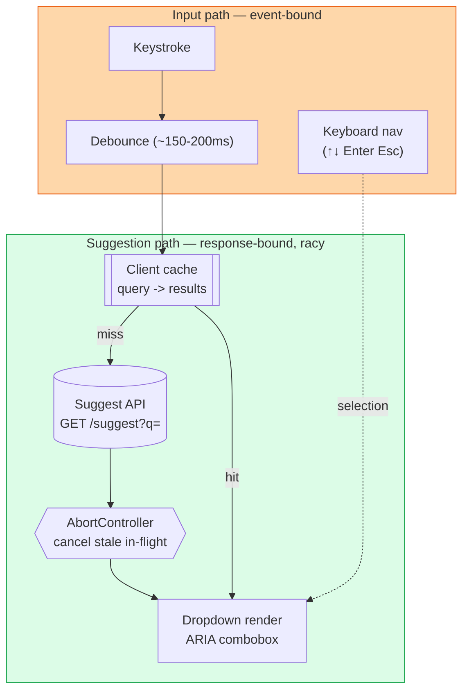

# Frontend System Design: Autocomplete

> **Session:** Mon — Spike track (Frontend system design, GFE). Timed target: 35–45 min.
> **Ships:** this written design + trade-offs. Cold-attempt it yourself first if you haven't; then diff against this.
> **Source pick:** `docs/gfe-study-guide.md` §3 — Autocomplete is the next undone GFE system-design pick after News Feed (Wk1). "Infinite scroll" is no longer a standalone system-design question per the study guide — it now lives as a UI-coding drill (§4) — so this session takes its place in sequence.

---

## 1. Clarify the problem

**Ask before designing. A senior candidate narrows scope out loud.**

Functional:
- User types in a search box; a dropdown of ranked suggestions appears as they type.
- User can select a suggestion by mouse or keyboard (arrow keys + Enter).
- Suggestions update as the query changes — no page reload, no explicit "search" click needed.

Non-functional (numbers, not vibes):
- Perceived latency: suggestions visible within ~100–300ms of the last keystroke — anything higher reads as laggy.
- Must not flood the network with a request per keystroke on fast typers (avg. typing speed ~200ms/char).
- Must degrade on slow/flaky networks — stale suggestions are better than a frozen dropdown.
- Fully keyboard-operable and screen-reader announced — this is an a11y-graded question.

**Out of scope (say this out loud too):** the ranking/relevance algorithm server-side, the search index (inverted index, trie, fuzzy match) — that's a backend/data-structures concern. Own the client: input handling, request lifecycle, rendering, and a11y.

---

## 2. The central split

**Input path (what the user is typing, event-bound) vs. suggestion path (what's rendered, response-bound and racy).**

Everything below is one of these two concerns. Debounce, keystroke handling, and keyboard nav belong to the input path. Request cancellation, caching, and race-resolution belong to the suggestion path. This split is what separates "just wire an onChange to fetch" from a defensible design.

---

## 3. High-level architecture

| Component | Job (one line) |
|---|---|
| Input handler | Captures keystrokes, tracks cursor/selection, debounces before firing a request. |
| Debounce layer | Collapses a burst of keystrokes into one request after ~150–200ms of silence. |
| Client cache | LRU keyed by normalized query string (`"sea"` -> results) — instant re-render on backspace-then-retype. |
| Request manager | One in-flight request per input; `AbortController` cancels the previous request when a new one fires. |
| Suggestion store | Ranked list for the *current* query only — no normalization needed here, unlike News Feed, since suggestions aren't cross-referenced entities. |
| Dropdown (ARIA combobox) | `role="combobox"` + `role="listbox"`/`option` wiring, keyboard nav, screen-reader announcements. |
| Highlight matcher | Bolds the matched substring in each suggestion — pure function, client-side, no extra request. |

**Why cancel in-flight requests instead of just ignoring their response:** if request A (`"ca"`) is slow and request B (`"cat"`) resolves first, a naive "last response wins" model can still let A's late response overwrite B's — a classic out-of-order race. `AbortController.abort()` on the previous request, plus a monotonically increasing request-id guard as a belt-and-suspenders check, guarantees the render always reflects the latest query, not the latest *response*.

---

## 4. Deep dive — the three things that actually get probed

### 4a. Debounce vs throttle — and why debounce wins here

| Approach | Behavior | Fit for autocomplete |
|---|---|---|
| No delay (fire per keystroke) | One request per character | Wasteful, causes the race problem above at scale |
| Throttle (fire at most every N ms) | Fires periodically *while* typing | Wrong model — you want to wait for a pause, not sample mid-burst |
| Debounce (fire N ms after last keystroke) | Fires once typing pauses | Correct — matches "user paused to see results" intent |

**Key takeaway:** debounce, not throttle — the semantic is "wait until they stop," not "sample periodically." Name the ~150–200ms window as a deliberate trade-off: too low and you're back to per-keystroke spam, too high and it reads as laggy.

### 4b. Caching strategy — prefix cache, not just exact-query cache

A naive cache keyed by the full query string misses an easy win: if `"cat"` is cached and the user backspaces to `"ca"` then retypes `"cat"`, an exact-match cache still helps. But a smarter client can also **client-side filter** a broader cached result set — e.g. cache the top-50 results for `"ca"`, and locally filter/re-rank for `"cat"` without a network round-trip at all, falling back to a real request only when the local filter looks thin.

**Key takeaway:** exact-match LRU cache is the safe default to name first; client-side prefix-filtering as a stretch optimization is the staff-level follow-up that shows you understand trading a network hop for a client-side scan.

### 4c. Keyboard interaction model — this is the a11y crux

Autocomplete's ARIA pattern (`combobox` + `listbox`) is one of the more commonly botched a11y patterns in real products. The contract:

- `Down`/`Up` arrows move a visually and programmatically highlighted option (`aria-activedescendant`, not DOM focus — focus stays on the input).
- `Enter` selects the highlighted option; `Escape` closes the dropdown without selecting.
- The input has `aria-expanded`, `aria-controls` pointing at the listbox id, and `aria-autocomplete="list"`.
- A visually-hidden `aria-live="polite"` region announces result count ("5 results available") since the dropdown's DOM change alone isn't reliably announced.

**Key takeaway:** `aria-activedescendant` (not moving real focus) is the detail that separates candidates who've actually built this from candidates who are guessing — say it explicitly.

---

## 5. Resilience & degradation

- **Stale-while-revalidate on the cache**: show cached suggestions instantly for a repeated prefix, refetch in background if the cache entry is older than a short TTL (e.g. 60s) — ranked results can drift.
- **Minimum query length gate**: don't fire a request for a 1-character query — too noisy, too broad, wastes a round-trip that will be immediately superseded.
- **Timeout + graceful empty state**: if the suggest API takes too long, show "no suggestions" rather than an infinite spinner blocking the dropdown.
- **Network-aware behavior**: on `navigator.onLine === false` or a detected slow connection, widen the debounce window rather than firing requests that will just queue up.

---

## 6. Accessibility (GFE explicitly grades this for Autocomplete)

- `role="combobox"` on the input, `role="listbox"` on the suggestion container, `role="option"` on each item.
- `aria-activedescendant` tracks the highlighted option id — screen reader announces the highlighted option without moving DOM focus off the input.
- `aria-live="polite"` region reports result count changes.
- Full keyboard operability: Tab to focus, type to search, arrows to navigate, Enter to select, Escape to dismiss — no mouse-only paths.
- Sufficient color contrast on the highlighted-match substring styling (a common miss — bold alone isn't enough for low-vision users).

---

## 7. Trade-offs summary (say these unprompted — this is the signal)

| Decision | Chose | Over | Why |
|---|---|---|---|
| Request timing | Debounce (~150–200ms) | Throttle / per-keystroke | Matches "wait for pause" intent; avoids request flood |
| Race resolution | AbortController + request-id guard | "Last response wins" (no cancel) | Guarantees latest *query* wins, not latest *response* |
| Caching | Exact-match LRU (+ optional prefix-filter stretch) | No cache | Instant re-render on backspace/retype; fewer round-trips |
| Highlight tracking | `aria-activedescendant` | Moving real DOM focus per option | Screen readers announce highlight without losing input focus/IME state |
| Empty/slow state | Timeout -> graceful empty state | Infinite spinner | Never leave the dropdown in an ambiguous loading limbo |

---

## 8. Architecture advantages — why this shape, not another

Splitting **input** (event-bound) from **suggestion** (response-bound) mirrors the same client/server-layering instinct as the News Feed design: the input layer never needs to know *how* results arrive, and the suggestion layer never needs to know *how* the user is typing. That's dependency inversion again — the render layer depends on a `Suggestion[]` contract, not on debounce internals or fetch mechanics. Swap debounce for a predictive-prefetch model later, and the dropdown component doesn't change.

It's testable by construction: debounce timing is a pure function of a time source (inject a fake clock, no real `setTimeout` waits in tests); the race-resolution logic is a pure function of `(requestId, latestRequestId) -> shouldRender: boolean`; the ARIA wiring is testable via `@testing-library/react` querying roles, not implementation details. Three seams, each independently unit-testable — same payoff as the News Feed split, applied to a different axis (event timing vs. entity normalization).

---

## 9. If asked to go further (staff-level follow-ups)

- **Client-side ranking blend**: merge a fast local trie/fuzzy-match (recent searches, favorites) with slower server results, showing local hits instantly while the network call is still in flight.
- **Predictive prefetch**: prefetch the likely next-character branch (e.g. after `"ca"`, speculatively warm `"cat"` and `"car"`) if server supports cheap prefix queries — hides latency further.
- **Multi-field autocomplete (e.g. address forms)**: same pattern, but suggestion selection needs to populate *multiple* downstream fields atomically — a good moment to mention optimistic form-state updates.

---

## Stretch (optional, timed 20–25 min): 1 DSA warm-up

Pick one, timed, from the trie / hash-map family (keep-warm, not deep — pairs with today's "prefix" theme):
- **Implement Trie (Prefix Tree)** — insert/search/startsWith — maps directly to how a real autocomplete backend indexes suggestions.
- Alternative if that one's cold-recall solid already: **Longest Common Prefix**.

Don't solve it here — do it live, then write one line on the pattern you used, per the "every block ends in an artifact" rule.
